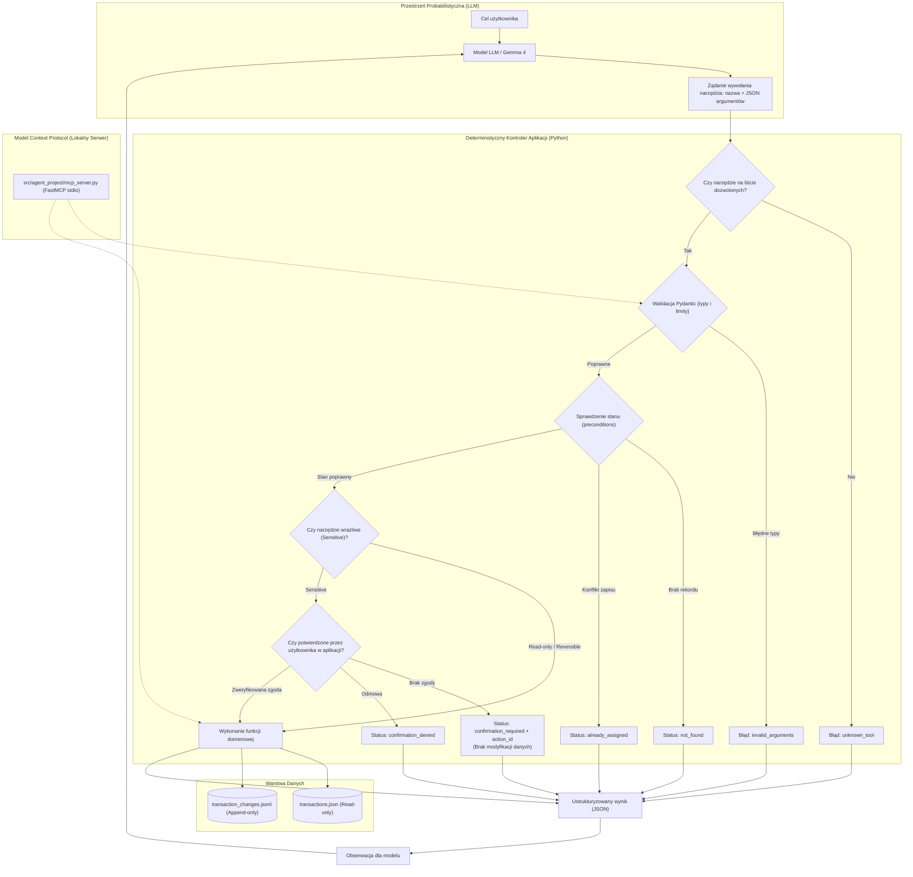

# Plan implementacji narzędzi, wywołań funkcji i MCP

Plan wdrożenia narzędzi transakcyjnych, ich wywoływania przez model i integracji MCP w projekcie **Household Expense Checker Agent**.

Status planu: UKOŃCZONO. Wszystkie Etapy 1–6 zostały zrealizowane; zamknięcie Etapu 6 potwierdza zweryfikowany ślad żywego modelu `evidence/trace_multitool_adaptation.jsonl` z `accepted: true` i pustą listą błędów. Ostatnia weryfikacja deterministyczna: 147 przechodzących testów, Ruff bez błędów.

---

## 1. Cel i zakres (Your Goal)

Głównym celem jest wyposażenie agenta w **trzy typowane rodzaje akcji domenowych** (read-only, reversible write, sensitive), przy jednoczesnym **utrzymaniu ostatecznej kontroli wykonania po stronie kodu aplikacji w Pythonie**, a nie modelu probabilistycznego.

```
Model probabilistyczny (proponuje)  ──[ Nazwa + JSON argumentów ]──>  Kontroler Python (decyduje i egzekwuje)
                                                                            │
                                                                   ┌────────┴────────┐
                                                                   ▼                 ▼
                                                             Wykonanie        Blokada / Błąd /
                                                            i zapis stanu    Wymóg potwierdzenia
```

Te same funkcje domenowe będą udostępnione na dwa sposoby bez duplikacji logiki:
1. Przez mechanizm function calling w pętli agenta (`src/agent_project/agent.py`).
2. Przez lokalny serwer MCP (`src/agent_project/mcp_server.py`).

**Zakres wykluczeń:**
Projekt nie realizuje bezpośrednich połączeń z API banków, zleceń przelewów ani przechowywania wrażliwych poświadczeń bankowych (PIN/hasła).

---

## 2. Trzy typy narzędzi domenowych i ich kontrakty

Każde narzędzie posiada dedykowany model wejściowy Pydantic (`BaseModel`), jasny opis docstring oraz zwraca jednolity, ustrukturyzowany słownik wynikowy (`status`, `result`/`error`, `action_id`).

### Tabela narzędzi domenowych

| Typ narzędzia | Nazwa narzędzia | Sygnatura i argumenty (Pydantic) | Zwracany status | Kontrola aplikacji w Pythonie (Guardrails) |
|---|---|---|---|---|
| **1. Read-only** | `search_transactions` | `query: str \| None = None`<br/>`merchant: str \| None = None`<br/>`category: str \| None = None`<br/>`min_amount: float \| None = None`<br/>`max_amount: float \| None = None`<br/>`limit: int = 10` | `success`<br/>`invalid_arguments` | **Walidacja wejścia:** kontroler sprawdza dozwoloną nazwę, typy Pydantic, zakresy (np. `limit <= 50`, `amount >= 0`). Narzędzie nie modyfikuje żadnego stanu. |
| **2. Reversible write** | `assign_category` | `transaction_id: str`<br/>`category: str`<br/>`rationale: str`<br/>`force_override: bool = False` | `success`<br/>`not_found`<br/>`already_assigned`<br/>`invalid_arguments` | **Walidacja stanu i przejścia:**<br/>1. Sprawdza istnienie transakcji (`not_found`).<br/>2. Jeśli transakcja ma już przypisaną kategorię, a `force_override=False`, kontroler odrzuca zapis i zwraca `already_assigned` wraz z obecną wartością.<br/>3. Zapis generuje `action_id` i zapisuje poprzednią wartość w dzienniku zmian, umożliwiając odwrócenie przez `undo_category_assignment(action_id)`. |
| **2a. Reversible write (Undo)** | `undo_category_assignment` | `action_id: str`<br/>`reason: str` | `success`<br/>`action_not_found`<br/>`state_conflict`<br/>`already_reverted` | **Kontrola konfliktu stanu:** cofa przypisanie tylko wtedy, gdy stan transakcji nie został zmieniony przez nowszą akcję. |
| **3. Sensitive** | `delete_flagged_transaction` | `transaction_id: str`<br/>`reason: str`<br/>`confirmed: bool = False` | `confirmation_required`<br/>`success`<br/>`not_found`<br/>`confirmation_denied` | **Egzekwowanie potwierdzenia (Human-in-the-loop):**<br/>1. Jeśli `confirmed=False` lub brak tokenu autoryzacji z aplikacji: kontroler **nie wykonuje usunięcia**, lecz rejestruje oczekującą akcję (`pending_action`) i zwraca status `confirmation_required` oraz `action_id`.<br/>2. **Model nie może sam potwierdzić akcji** — flaga/token potwierdzenia może pochodzić wyłącznie z zewnętrznego interfejsu aplikacji (np. hook potwierdzenia w CLI lub test runnerze). |

---

## 3. Architektura kontrolera i jedno źródło prawdy dla schematów

### 3.1. Zasada jednego źródła prawdy (Single Source of Truth)
Definicje Pydantic w `src/agent_project/tools.py` stanowią jedyne źródło schematów:
* Modele Pydantic generują deklaracje JSON Schema (`model.model_json_schema()`) dla OpenAI `tools` w `agent.py`.
* Te same modele walidują argumenty w runtime (`model.model_validate(raw_args)`).
* Te same modele i funkcje są eksponowane w serwerze MCP (`FastMCP`).
* **Zero duplikacji logiki biznesowej i schematów.**

### 3.2. Zarządzanie stanem i trwałością (Append-only Ledger)
1. **Nienaruszalność danych wejściowych:** Plik `data/transactions.json` jest ściśle **read-only** (repozytorium transakcji bazowych).
2. **Dziennik zmian (Event Sourcing):** Wszelkie modyfikacje (przypisanie kategorii, cofnięcie, logiczne usunięcie) zapisywane są w append-only pliku `data/transaction_changes.jsonl`.
3. **Efektywny stan transakcji:** Funkcje odczytu aplikują sekwencję zdarzeń z `transaction_changes.jsonl` na dane z `transactions.json`, wyliczając aktualny stan w pamięci.

### 3.3. Cykl życia potwierdzeń akcji wrażliwych (Confirmation Lifecycle)
```
[Model żąda: delete_flagged_transaction(tx_104)]
                         │
                         ▼
           [Kontroler Python: walidacja]
                         │
                         ├─► Czy akcja zatwierdzona przez aplikację?
                         │
        NIE ─────────────┴───────────── TAK (zweryfikowany token/hook)
         │                                    │
         ▼                                    ▼
[Utwórz pending_action]               [Wykonaj usunięcie w dzienniku]
[Zwróć: confirmation_required]        [Zwróć: success]
[Model informuje użytkownika]
```

---

## 4. Diagram odpowiedzialności: Model vs Aplikacja Python



---

## 5. Scenariusze „A Run That Counts” (Adaptacja do obserwacji)

Wymóg kluczowy zadania: **obserwacja zwrócona z pierwszego narzędzia musi determinować kolejny krok agenta**. Implementujemy i testujemy trzy odrębne scenariusze adaptacji:

### Scenariusz A: Wymóg potwierdzenia akcji wrażliwej (`confirmation_required`)
1. **Cel:** „Przeanalizuj i usuń zduplikowane obciążenie za Spotify”.
2. **Krok 1 (Read-only):** Agent wywołuje `search_transactions(merchant="Spotify")`.
3. **Obserwacja 1:** Zwrócono 2 transakcje (`tx_103` i `tx_104` po 24.99 PLN).
4. **Krok 2 (Sensitive attempt):** Agent decyduje się usunąć nadmiarową transakcję: `delete_flagged_transaction(transaction_id="tx_104", reason="duplicate")`.
5. **Obserwacja 2:** Kontroler Pythona blokuje wykonanie i zwraca:
   ```json
   {
     "status": "confirmation_required",
     "action_id": "act_del_tx_104",
     "message": "Operacja usunięcia wymaga jawnego potwierdzenia użytkownika."
   }
   ```
6. **Krok 3 (Reakcja agenta):** Model zmienia plan — **nie zgłasza fałszywego sukcesu usunięcia**, lecz formułuje do użytkownika pytanie z prośbą o akceptację podając identyfikator akcji. Dane pozostają nienaruszone.

### Scenariusz B: Wykrycie istniejącej kategorii (`already_assigned`)
1. **Cel:** „Przypisz kategorię Groceries do transakcji tx_101”.
2. **Krok 1 (Write attempt):** Agent wywołuje `assign_category(transaction_id="tx_101", category="Groceries")`.
3. **Obserwacja 1:** Transakcja ma już kategorię `Groceries`. Kontroler zwraca:
   ```json
   {
     "status": "already_assigned",
     "transaction_id": "tx_101",
     "current_category": "Groceries",
     "message": "Transakcja posiada już tę kategorię. Użyj force_override=True aby zmienić."
   }
   ```
4. **Krok 2 (Reakcja agenta):** Agent obserwuje brak konieczności zapisu i kończy odpowiedź informacją, że kategoria jest już aktualna, unikając zbędnego zapisu.

### Scenariusz C: Brak transakcji i wyszukiwanie alternatywne (`not_found`)
1. **Cel:** „Zmień kategorię dla płatności za paliwo na Shell”.
2. **Krok 1:** Agent wywołuje `search_transactions(merchant="Shell")`.
3. **Obserwacja 1:** Wynik `[]` (brak transakcji).
4. **Krok 2 (Reakcja agenta):** Agent adaptuje zapytanie i szuka ogólnie w kategorii `Transport` lub merchantu `Orlen`, odnajdując właściwą stację paliw.

---

## 6. Specyfikacja lokalnego serwera MCP

1. **Pakiet:** Oficjalne Python SDK `mcp>=1.0.0` (komponent `mcp.server.fastmcp.FastMCP`).
2. **Lokalizacja:** `src/agent_project/mcp_server.py`.
3. **Udostępnione narzędzia:**
   * `search_transactions`: wyszukiwanie transakcji z pełnym zestawem filtrów.
   * `assign_category`: przypisywanie kategorii z kontrolą stanu.
   * `compute_budget_baseline`: statystyki wydatków historycznych.
4. **Zasada implementacji:**
   ```python
   # src/agent_project/mcp_server.py
   from mcp.server.fastmcp import FastMCP
   from agent_project.tools import search_transactions, assign_category, compute_budget_baseline

   mcp = FastMCP("HouseholdExpenseTracker")

   @mcp.tool()
   def search_household_transactions(query: str | None = None, merchant: str | None = None) -> dict:
       """Search household transactions with filtering."""
       return search_transactions(query=query, merchant=merchant)
   ```
5. **Transport:** `stdio` (standard input/output) umożliwiający integrację z Antigravity CLI, Claude Desktop lub dowolnym klientem zgodnym ze specyfikacją MCP.
6. **Uruchomienie:**
   ```bash
   uv run python -m agent_project.mcp_server
   ```

---

## 7. Plan testów deterministycznych (`tests/`)

Wszystkie testy muszą działać powtarzalnie w CI/lokalnie bez zewnętrznych zależności sieciowych (`uv run pytest`):

1. **Testy walidacji schematów (`tests/test_tool_validation.py`):**
   * Wywołanie z błędnym typem argumentu (np. `limit="duzo"`) → natychmiastowe odrzucenie z `invalid_arguments`.
   * Przekazanie nieznanego narzędzia → obsługa błędu `unknown_tool`.
   * Walidacja wartości brzegowych (ujemne kwoty, limity).
2. **Testy kontrolera i akcji domenowych (`tests/test_controlled_actions.py`):**
   * Próba wywołania `delete_flagged_transaction` bez potwierdzenia → wynik `confirmation_required`, brak zmian w plikach.
   * Wywołanie z poprawnym potwierdzeniem aplikacji → `success` i dopisanie rekordu do `transaction_changes.jsonl`.
   * Test odwracalności: `assign_category` → weryfikacja stanu → `undo_category_assignment` → przywrócenie stanu początkowego.
   * Test konfliktu cofnięcia (próba cofnięcia po nadpisaniu nowszą akcją → `state_conflict`).
   * Test nienaruszalności `data/transactions.json` (plik źródłowy zachowuje nienaruszony hash).
3. **Testy adaptacji agenta (`tests/test_agent_adaptation.py`):**
   * Mock test pętli agenta dla Scenariusza A (`confirmation_required` zatrzymuje usunięcie i wymusza pytanie do użytkownika).
   * Mock test dla Scenariusza B (`already_assigned` zapobiega nadpisaniu).
4. **Testy serwera MCP (`tests/test_mcp_server.py`):**
   * Weryfikacja rejestracji narzędzi w `FastMCP`.
   * Wywołanie narzędzia przez interfejs MCP i sprawdzenie zgodności wyniku z bezpośrednim wywołaniem Pythona.

---

## 8. Harmonogram wdrożenia krok po kroku

```
Etap 1: Zależności i konfiguracja [UKOŃCZONO]
├── Dodano mcp>=1.2.0,<2 do pyproject.toml
├── uv sync & zweryfikowano FastMCP 1.30.0
├── Utworzono modele Pydantic w src/agent_project/models.py
└── Dodano testy walidacji w tests/test_tool_validation.py (31 passed)

Etap 2: Narzędzia domenowe i ledger zdarzeń (tools.py) [UKOŃCZONO]
├── Implementacja append-only ledgeru (data/transaction_changes.jsonl)
├── Nienaruszalność bazowego data/transactions.json zweryfikowana
├── search_transactions, get_transaction_details, compute_budget_baseline
├── assign_category z kontrolą already_assigned i unikalnymi action_id
├── undo_category_assignment z kontrolą konfliktów stanu
├── delete_flagged_transaction z blokadą confirmation_required
├── Automatyczne generowanie TOOL_DEFINITIONS z modeli Pydantic
└── Dodano testy w tests/test_controlled_actions.py (40 passed)

Etap 3: Kontroler i rozbudowa pętli agenta (agent.py) [UKOŃCZONO]
├── execute_controlled_tool z twardą walidacją
├── Automatyczne generowanie TOOL_DEFINITIONS z modeli Pydantic
├── Obsługa statusu confirmation_required w promptcie i pętli
└── Blokada fałszowania potwierdzeń przez model

Etap 4: Serwer MCP (mcp_server.py) [UKOŃCZONO]
├── Implementacja FastMCP stdio
└── Eksport kanonicznych narzędzi domenowych

Etap 5: Zestaw testów deterministycznych (pytest) [UKOŃCZONO]
├── test_tool_validation.py
├── test_controlled_actions.py
├── test_agent_adaptation.py
└── test_mcp_server.py

Etap 6: Ślady i weryfikacja końcowa [UKOŃCZONO]
├── Żywy przebieg lokalnego modelu: passed (uruchomiony przez użytkownika)
├── Zweryfikowany ślad evidence/trace_multitool_adaptation.jsonl: accepted=true, errors=[]
├── Dodano multitool_demo.py z izolacją danych i walidacją dowodu wykonania
├── Aktualizacja README.md o MCP i nowe narzędzia: UKOŃCZONO
└── Weryfikacja pytest i Ruff: UKOŃCZONO (147 passed)
```

---

### Wynik weryfikacji Etapu 3

Etap 3 dokończono po przeglądzie przerwanych zmian w `agent.py` i `tests/test_agent_adaptation.py`. Zakres prac nie obejmował uruchamiania kolejnych etapów ani testu z żywym modelem.

* Kontroler odrzuca nieznane narzędzia, niepoprawny JSON, argumenty inne niż obiekt JSON, niedozwolone pola oraz błędne typy i zakresy. Walidacja Pydantic działa z `strict=True`, bez niejawnej konwersji typów.
* Schematy `TOOL_DEFINITIONS` pozostają generowane z istniejących modeli Pydantic. Test sprawdza zgodność modeli używanych w kontrolerze z opublikowanymi schematami.
* Naprawiono wywołanie kompatybilnego `get_transactions`: kontroler deleguje je do `search_transactions`, zgodnie z zakresem parametrów już publikowanym w jego schemacie.
* Wyniki odczytów otrzymują ustrukturyzowany status `success`; statusy domenowe i błędy są przekazywane jako obserwacje do modelu.
* Modelowe `confirmed=True` nie autoryzuje usunięcia. Usunięcie wymaga literalnego `True` ze zaufanego hooka aplikacji; odmowa, inne wartości i wyjątek hooka nie powodują zapisu.
* Hook otrzymuje identyfikator oczekującej akcji oraz kopię zwalidowanych argumentów z `confirmed=False`. Nie może przez modyfikację tej kopii zmienić transakcji, która zostanie usunięta.
* Przed pytaniem o potwierdzenie sprawdzane jest istnienie transakcji. Bez hooka kontroler zwraca `confirmation_required`, bez modyfikacji danych.
* Test adaptacji wybiera kolejne wywołania na podstawie rzeczywistych obserwacji: pusty wynik wyszukiwania → wyszukiwanie alternatywne → próba akcji wrażliwej → pytanie o zgodę. Nie jest to wyłącznie z góry ustalona lista odpowiedzi mocka.
* Zachowano testy scenariuszy `confirmation_required` i `already_assigned`, dodano pokrycie niepoprawnych argumentów, autoryzacji, odczytów, zapisu i cofnięcia oraz obsługi błędnego JSON w pętli i śladzie.

Weryfikacja lokalna w istniejącym środowisku projektu:

```text
.venv/bin/python -m pytest -ra
85 passed

.venv/bin/python -m pytest tests/test_agent_adaptation.py --collect-only
45 tests collected

.venv/bin/ruff check .
All checks passed!

git diff --check
Brak błędów.
```

W momencie zakończenia Etapu 3 pozostałe elementy harmonogramu (Etapy 4–6), w tym MCP i ślad z żywego modelu, pozostawały do wykonania. Rozszerzenie testów kontrolera stanowi weryfikację Etapu 3, a nie deklarację ukończenia całego Etapu 5.

### Wynik weryfikacji Etapu 4

Dodano `src/agent_project/mcp_server.py` z lokalnym serwerem FastMCP uruchamianym przez transport stdio. Udostępnia dokładnie trzy narzędzia z planu: `search_transactions`, `assign_category` i `compute_budget_baseline`.

* Serwer jest cienkim adapterem istniejącego kontrolera `execute_controlled_tool`. Korzysta z tych samych funkcji domenowych, walidacji i ledgera co agent, bez kopiowania implementacji narzędzi.
* Publiczne metody `list_tools` i `call_tool` FastMCP zapewniają odkrywanie narzędzi oraz przekazywanie oryginalnych argumentów do kontrolera. Pozwala to zachować ścisłą walidację bez wcześniejszej konwersji typów przez automatyczne wrappery SDK.
* Schematy wejściowe są generowane bezpośrednio z modeli Pydantic używanych przez kontroler. Nazwy narzędzi ogranicza osobna, stała lista dozwolona dla MCP.
* `delete_flagged_transaction` i inne niewyeksportowane narzędzia są odrzucane również przy bezpośredniej próbie ich wywołania przez klienta MCP.
* Ścieżki danych i ledgera ustala aplikacja przez `create_server(...)` lub opcje startowe `--data-path` i `--changes-path`. Nie są argumentami narzędzi dostępnymi dla modelu.
* MCP zwraca ustrukturyzowane wyniki z tymi samymi statusami co agent. Przypisanie kategorii zapisuje zdarzenie w istniejącym ledgerze i nie modyfikuje źródłowego `transactions.json`.
* Dodano 18 testów w `tests/test_mcp_server.py`, obejmujących schematy, zgodność odczytów z kontrolerem, walidację, blokadę narzędzi spoza listy i wspólny stan zapisu.
* Test integracyjny uruchamia rzeczywisty proces serwera i klienta MCP przez stdio, wykonuje `initialize`, `list_tools` oraz wywołania narzędzi, w tym zapis do tymczasowego ledgera. Nie wymaga modelu, sieci ani zmian rzeczywistych danych projektu.

Uruchomienie serwera lokalnego:

```bash
uv run python -m agent_project.mcp_server
```

Opcjonalne, kontrolowane przez aplikację ścieżki danych:

```bash
uv run python -m agent_project.mcp_server \
  --data-path /path/to/transactions.json \
  --changes-path /path/to/changes.jsonl
```

Serwer oczekuje komunikatów protokołu MCP na stdin i odpowiada na stdout; nie jest interaktywnym CLI tekstowym. Weryfikacja w istniejącym środowisku projektu:

```text
.venv/bin/python -m pytest -ra
103 passed

.venv/bin/ruff check .
All checks passed!

git diff --check
Brak błędów.
```

W momencie zakończenia Etapu 4 etapy 5 i 6 pozostawały do wykonania; powyższe testy stanowiły weryfikację adaptera MCP, a nie deklarację ukończenia całego zakresu Etapu 5.

### Wynik weryfikacji Etapu 5

Uzupełniono deterministyczne testy we wszystkich czterech obszarach wskazanych w planie. Pełny zestaw liczy 139 testów (36 więcej niż po Etapie 4); testy nie wymagają żywego modelu ani dostępu do sieci.

| Plik | Liczba testów | Zakres |
| --- | --- | --- |
| `tests/test_tool_validation.py` | 26 | Typy, limity, wartości brzegowe i nieznane nazwy narzędzi; kontroler zwraca `unknown_tool`, zgodnie z istniejącym kontraktem. |
| `tests/test_controlled_actions.py` | 19 | Zapis, cofanie, konflikty nowszych akcji, blokada nadpisania, potwierdzenie aplikacji i niezmienność ledgera przy odmowie. |
| `tests/test_agent_adaptation.py` | 48 | Scenariusze A i B oparte na rzeczywistych obserwacjach oraz blokada ponawianych prób samodzielnego potwierdzenia przez model. |
| `tests/test_mcp_server.py` | 23 | Rejestracja, walidacja, rzeczywista sesja stdio i zgodność MCP z bezpośrednimi funkcjami domenowymi, także dla zapisu. |

Pozostałe 23 testy należą do dotychczasowych zestawów `test_agent.py`, `test_setup.py` i `test_tools.py`; również przechodzą.

Dodano `tests/conftest.py` z małym, stałym zbiorem transakcji, tymczasowymi ścieżkami oraz kontrolą SHA-256 źródłowego pliku po każdym teście korzystającym z tej fixture. Nowe testy scenariuszy nie zależą od zawartości roboczego zbioru transakcji projektu.

Testy regresyjne najpierw odtworzyły dwie niezgodności z istniejącymi wymaganiami, po czym wprowadzono minimalne poprawki w `tools.py`:

* `assign_category` blokuje każdą próbę nadpisania istniejącej, niepustej kategorii bez `force_override=True`, nie tylko ponowne przypisanie tej samej wartości.
* `undo_category_assignment` sprawdza również `last_action_id`. Nowszy zapis tej samej kategorii albo zmiana i powrót do poprzedniej wartości powodują `state_conflict`, zamiast pozwalać cofnąć nieaktualną akcję. Nowsza akcja dotycząca innej transakcji nie blokuje poprawnego cofnięcia.

Scenariusz A wykrywa duplikat, przekazuje wybrany identyfikator do akcji wrażliwej i po `confirmation_required` zwraca pytanie o zgodę bez usuwania. Scenariusz B po `already_assigned` zmienia narzędzie i cel: wyszukuje nieskategoryzowaną transakcję zamiast wymuszać nadpisanie. Mocki sprawdzają treść faktycznych wyników narzędzi przed wyborem kolejnego działania.

Weryfikacja pełnego zestawu została powtórzona, a każdy z czterech zestawów uruchomiono także osobno. Polecenia w istniejącym środowisku, bez synchronizacji zależności i z lokalnym cache dostępnym w sandboxie:

```text
UV_CACHE_DIR=/tmp/ai-agent-uv-cache UV_OFFLINE=1 uv run --no-sync pytest -ra
139 passed

UV_CACHE_DIR=/tmp/ai-agent-uv-cache UV_OFFLINE=1 uv run --no-sync ruff check .
All checks passed!

git diff --check
Brak błędów.

git diff --exit-code -- data/transactions.json
Brak zmian.
```

SHA-256 pliku `data/transactions.json` pozostał bez zmian:

```text
83f372f6c4ca83e4850984f5af6d676df18ce9933842ed7f7ef1142a41129671
```

W momencie zakończenia Etapu 5 nie rozpoczęto jeszcze Etapu 6: nie uruchamiano żywego modelu, nie generowano końcowego śladu w `evidence/` i nie aktualizowano README na potrzeby tego etapu.

### Wynik weryfikacji Etapu 6

Użytkownik uruchomił demonstrację lokalnie i otrzymał `status: passed`. Weryfikacja zapisanego śladu potwierdziła przebieg z lokalnym modelem.

Wykonano:

* Dodano `src/agent_project/multitool_demo.py`, uruchamiany przez `uv run python -m agent_project.multitool_demo`. Korzysta z rzeczywistego `LocalClient`, wymaga endpointu loopback i nie przełącza demonstracji na usługę chmurową.
* Demonstracja działa na tymczasowej kopii danych oraz świeżym, tymczasowym ledgerze. Nie dostarcza hooka potwierdzenia, więc nie może autoryzować usunięcia. Źródło i rzeczywisty ledger projektu pozostają poza zapisem narzędzi w tym przebiegu.
* Walidacja wymaga ukończenia agenta, co najmniej dwóch różnych narzędzi, odczytu zakończonego niepustym wynikiem przed próbą usunięcia w późniejszym kroku, `confirmation_required`, pytania z identyfikatorem oczekującej akcji oraz braku zmian stanu. Sprawdza też obecność opóźnienia i zużycia tokenów.
* Kanoniczny ślad `evidence/trace_multitool_adaptation.jsonl` jest tworzony wyłącznie po pozytywnej walidacji żywego przebiegu. Próby nieudane i testy z klientem wstrzykniętym są odrzucane jako dowód sukcesu i zapisywane pod osobną nazwą. Istniejące ślady nie są nadpisywane.
* Dodano 8 testów w `tests/test_multitool_demo.py`: akceptacja i odrzucanie struktury dowodu, ochrona istniejących plików, rozdzielenie mocków od żywego wykonania i bezpieczny zapis diagnostyki bez treści wyjątków mogących zawierać ścieżki lub sekrety.
* Uaktualniono README: bieżąca architektura, narzędzia i ich zabezpieczenia, schemat model–kontroler–dane, serwer MCP i konfiguracja klienta, uruchamianie demonstracji i interpretacja jej statusu. Usunięto nieaktualne twierdzenie, że pętla agenta i narzędzia nie są zaimplementowane, oraz niezweryfikowane gwarancje pamięci i wydajności.

Historyczna nieudana próba wykonania przez narzędzie z 2026-10-25:

```text
Model z konfiguracji: hf.co/unsloth/gemma-4-12b-it-GGUF:Q4_K_M
Endpoint z konfiguracji: http://localhost:11434/v1

ollama list
connect: operation not permitted

.venv/bin/python -m agent_project.multitool_demo
status: blocked
errors: ["APIConnectionError"]
trace_path: evidence/trace_multitool_adaptation_attempt_20261025_002216_103533.jsonl
```

Ten ślad próby zawiera `demo_start`, `agent_start` i `demo_failed`, ale nie zawiera odpowiedzi modelu ani wykonanych decyzji narzędziowych. Pozostaje zapisem diagnostycznym, nie dowodem sukcesu; późniejszy poprawny przebieg użytkownika spełnia wymaganie mimo utrzymującego się ograniczenia sieciowego narzędzia.

Końcowy przebieg uruchomiony przez użytkownika:

```text
uv run python -m agent_project.multitool_demo
status: passed
trace_path: evidence/trace_multitool_adaptation.jsonl
errors: []
```

Odczyt śladu potwierdził:

* Krok 1: `search_transactions` zwrócił `success` oraz transakcje Spotify.
* Krok 2: `delete_flagged_transaction` zwrócił `confirmation_required`, zamiast wykonać usunięcie bez zgody.
* Krok 3: model zakończył przebieg pytaniem o zgodę na usunięcie `tx_104`, podał `pending_del_tx_104` i wyraźnie zaznaczył, że niczego nie usunięto.
* `demo_validation`: `accepted: true`, `errors: []`; hash bazowych danych to `83f372f6c4ca83e4850984f5af6d676df18ce9933842ed7f7ef1142a41129671`.

Model w śladzie to `hf.co/unsloth/gemma-4-12b-it-GGUF:Q4_K_M`, z dostawcą `local`. Potwierdzono dwie decyzje narzędziowe w osobnych krokach oraz zmianę zachowania po obserwacji wymagającej potwierdzenia.

Weryfikacja deterministyczna:

```text
UV_CACHE_DIR=/tmp/ai-agent-uv-cache UV_OFFLINE=1 uv run --no-sync pytest -ra
147 passed

UV_CACHE_DIR=/tmp/ai-agent-uv-cache UV_OFFLINE=1 uv run --no-sync ruff check .
All checks passed!

git diff --check
Brak błędów.

git diff --exit-code -- data/transactions.json
Brak zmian.
```

Wdrożenie narzędzi i integracji MCP zakończono po zweryfikowaniu zapisanego śladu demonstracji.

## 9. Weryfikacja i kryteria akceptacji

1. **Trzy typowane narzędzia:** Zaimplementowane w Pythonie (read-only, reversible write z funkcją undo, sensitive).
2. **Kontrola aplikacji:** Żadna akcja wrażliwa nie wykonuje się bez zweryfikowanego potwierdzenia; model nie może sam wygenerować zgody.
3. **Serwer MCP:** Działający lokalny serwer stdio udostępniający te same funkcje co agent (zero code duplication).
4. **Dowód adaptacji („A Run That Counts”):** Ślad `evidence/trace_multitool_adaptation.jsonl` demonstruje odczyt danych, próbę akcji wrażliwej oraz zmianę kolejnego kroku agenta na pytanie o zgodę po `confirmation_required`.
5. **Jakość kodu i testy:** 100% przechodzących testów jednostkowych w `pytest`, zero błędów `ruff`, aktualna dokumentacja w `README.md`.
