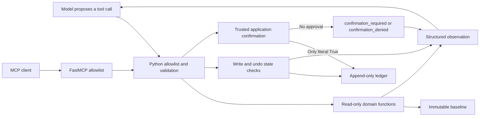
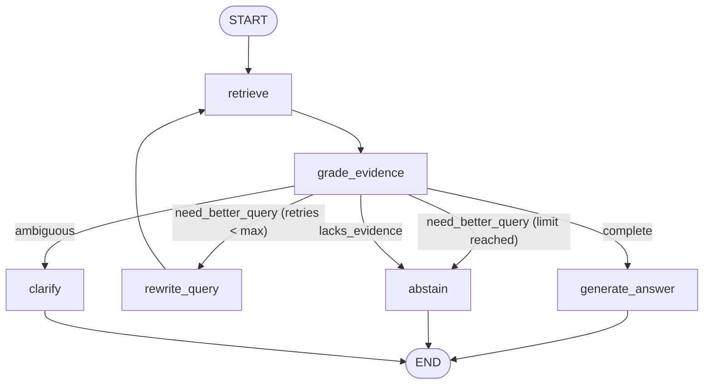

# Household Expense Checker Agent

Analyzes household transactions for duplicate charges and unexpected expenses.
The agent combines transaction tools, explicit approval for deletion, and
answers grounded in household policy documents.

## Setup

Clone the repository and install its dependencies:

```bash
git clone <your-repository-url>
cd <your-repository-directory>
uv sync --locked
cp .env.example .env
uv run pytest
```

Configure your local model endpoint in `.env`. The current example targets Ollama
at `http://localhost:11434/v1` with
`MODEL_NAME=hf.co/unsloth/gemma-4-12b-it-GGUF:Q4_K_M`. This is a configuration
target, not a claim that the model has been installed or benchmarked. Start your
local server and verify the exact installed model name before testing:

```bash
uv run python -c 'from agent_project.llm import OpenRouterClient; print(OpenRouterClient().complete([{"role": "user", "content": "Reply with exactly MODEL_READY"}])["text"])'
```

## Project Brief

- **Project title:** Household Expense Checker Agent
- **Intended user:** Individuals and households managing everyday personal budgets and shared domestic expenses (e.g., groceries, utility bills, subscriptions, dining, and family shopping).
- **Problem and primary task:** Maintaining a personal or household budget is tedious and frequently abandoned because bank statements often feature vague merchant names, mixed purchases (e.g., a supermarket trip combining groceries, home supplies, and electronics), and unexpected cost spikes (e.g., sudden utility rate increases or forgotten subscription renewals). The primary task is to inspect personal/household bank transactions, detect unusual or ambiguous expenses, proactively request brief clarification from the user before finalizing category assignments, and maintain an accurate household budget breakdown.
- **User requests (what they ask for):** "Review my latest household bank transactions, identify any unusual expenses or duplicates, ask me for clarification on ambiguous charges, and assign proper budget categories."
- **What a good result looks like:** Routine expenses (groceries, regular utilities, known subscriptions) are categorized accurately and silently; anomalous items (unusual spikes, unknown vendors, double billings) are explicitly flagged with concise clarification prompts; and all decisions are logged in a structured JSONL trace with latency and token usage.
- **Why an agent is appropriate:** Rigid budgeting rules or basic keyword matchers cannot disambiguate multi-category stores or detect contextual anomalies across a family's typical spending patterns. An LLM/VLM agent can reason about household spending habits, inspect smartphone photos of paper receipts to verify itemized purchases, ask contextual and low-friction clarification questions, and incorporate user feedback to refine categorization.
- **Planned data:** Anonymized household bank transaction logs (CSV/JSON containing timestamps, amounts, merchant descriptions, payment methods, and historical budget categories) and sample paper receipt photos (grocery slips, utility bills, restaurant receipts).
- **Planned tools:**
  - `get_household_transactions`: Fetch and filter recent personal/household bank transactions.
  - `compute_budget_baseline`: Calculate typical household spending ranges and anomaly thresholds by category and merchant (e.g., typical grocery basket size, normal utility bill ranges).
  - `request_user_clarification`: Prompt the household member with a concise question and suggested category choices for anomalous or ambiguous expenses.
  - `assign_category`: Record the confirmed budget category (e.g., Groceries, Utilities, Entertainment, Healthcare, Home Improvement) with a rationale and confidence rating.
- **Implemented tools:**
  - `get_transactions(limit=10, merchant=None)`: Read-only search fetching recent transactions with optional merchant filtering.
  - `get_transaction_details(transaction_id)`: Read-only retrieval of full transaction records and notes.
  - `compute_budget_baseline(merchant=None, category_hint=None)`: Read-only calculation of historical spending averages, min/max bounds, and counts to detect price spikes.
  - `find_duplicate_candidates()`: Read-only detection of repeated charges (same merchant and amount within a 3-day window).
  - `evidence/trace_successful.jsonl` (`trace_20261022_multistep.jsonl`): Demonstrates a successful multi-step investigation loop (duplicate scan -> detail inspection -> baseline comparison -> structured report).
  - `evidence/trace_unsuccessful.jsonl`: Demonstrates an unsuccessful execution bounded by the step limit (`step_limit_reached`).
  Each trace records the model name, provider, token usage, cost, and latency per step.
- **Planned visual input:** Smartphone photos of supermarket receipts, restaurant slips, and utility bill statements to inspect itemized line items when transaction descriptions are vague or amounts deviate from typical household baselines.
- **Success criteria:**
  - Accurately identifies household spending anomalies (e.g., unusual price spikes, forgotten subscription renewals, duplicate charges).
  - Automatically categorizes at least 90% of routine household transactions without requiring user input.
  - Keeps clarification requests targeted, concise, and easy for the user to answer.
  - Targets local hardware (MacBook Pro M1 Pro 16GB) using a quantized Gemma model within bounded execution (<= 12 model steps per run). Live performance is a separate verification requirement.
- **Non-goals and safety boundaries:**
  - Non-goals: Direct bank account manipulation, automated bill payments, investment/tax advice, or debt management.
  - Safety boundaries: Zero handling or storage of real banking credentials, payment card numbers, or unredacted personal identifiers (PII). Operates only on sanitized personal finance data and avoids guessing ambiguous household expenses without user clarification.

## Implemented architecture

- **`agent.py`:** Bounded model/tool loop and the deterministic
  `execute_controlled_tool` controller.
- **`models.py`:** Pydantic argument models shared by validation and generated
  tool schemas. The controller forbids extra fields and validates strict types.
- **`tools.py`:** Domain functions and append-only event ledger.
- **`mcp_server.py`:** Local FastMCP stdio adapter using the same controller,
  models, functions, and state as the agent.
- **`llm.py`:** OpenAI-compatible local/OpenRouter client and `MockClient`.
  Live responses include model/provider, latency and usage. The client defaults
  to 1,024 output tokens and a 300-second read timeout.
- **`tracing.py`:** JSONL events with basic field-based secret redaction.
- **`multitool_demo.py`:** Isolated live-run demonstration and evidence validation.
- **`data/transactions.json`:** Sanitized, immutable baseline dataset.
- **`data/transaction_changes.jsonl`:** Generated append-only state changes.
- **`traces/` and `evidence/`:** Working traces and verification results.

## Run the web application

The browser UI serves the same controlled domain logic as the CLI and MCP
tools. Start it from the repository root:

```bash
uv run python -m agent_project.web
```

Open `http://127.0.0.1:8765` in your local browser. The service listens on the
loopback interface only (`127.0.0.1` is the only accepted `--host`), so it is
not reachable from a LAN or from other devices. Alternative options:

```bash
uv run python -m agent_project.web --port 8890 \
  --data-path /tmp/transactions.json \
  --changes-path /tmp/changes.jsonl
```

Stop the service with Ctrl+C; the process exits cleanly and releases the port.
A subsequent start on the same port works without extra steps because the
disk files (baseline and append-only ledger) carry all persistent state.

### Local model configuration

The service starts and reads data without a model: opening the page shows the
English transaction list and never starts an analysis. Starting an analysis
requires the local model configured in `.env` (`MODEL_NAME`, `LLM_BASE_URL`,
for example the Ollama-compatible endpoint from the Setup section above).
Without a reachable model, a started run fails with an English catalog
message and the page keeps working for reads.

### Consents, conflicts and limitations

- Deletion is the one sensitive action: the model cannot delete a
  transaction by itself. The UI shows a pending-decision card; you approve or
  reject it explicitly, and one decision affects exactly one transaction.
- There is no inference cancellation. A started analysis runs to a terminal
  status (`completed`, `step limit reached` or `failed`); while a run is
  active the start button is disabled and any other start attempt is
  rejected with a conflict message instead of being queued.
- A service restart discards in-memory session, run and pending-decision
  state. A pending decision cannot be completed after a restart: a stale
  start attempt gets a `409 instance_changed` answer from the backend and
  the page only asks you to refresh and start a new analysis. Already-approved
  effects stay in the append-only ledger.
- P1 items stay out of the MVP scope and are not implemented in this UI:
  the run-details view (AC-27) and manual category correction with undo
  (AC-28–AC-29).

## Tools and application controls

| Tool | Type | Application-controlled result |
| --- | --- | --- |
| `search_transactions` | Read-only | Filters by query, merchant, category, amount and limit (1–50). |
| `get_transaction_details`, `compute_budget_baseline`, `find_duplicate_candidates` | Read-only | Details, statistics and duplicate candidates without state changes. |
| `get_transactions` | Compatibility alias | Uses the search schema and controller dispatch. |
| `assign_category` | Reversible write | Checks existence; any nonempty existing category requires `force_override=True`. Returns `action_id` and previous category. |
| `undo_category_assignment` | Reversible write | Rejects missing/reverted actions and newer changes to the same transaction, including same-value overwrites. |
| `delete_flagged_transaction` | Sensitive | Returns `confirmation_required` unless a trusted application callback explicitly returns literal `True`. |

The model proposes a name and JSON arguments; Python decides whether execution
is allowed. Unknown names, invalid arguments and state conflicts become
structured observations for the next model decision.



`confirmed=True` supplied by the model is not approval. Without a callback,
deletion returns an ID such as `pending_del_tx_104` and changes nothing; the
application must obtain real user consent before a callback authorizes a retry.
The generic command-line agent does not implement an interactive approval UI.
Use only sanitized datasets and do not attach a callback that approves every call.

Writes append events to the ledger, never rewrite the baseline. Effective state
is reconstructed from both files; undo also records an event rather than deleting
history. Concurrent multi-process ledger writes are not claimed to be supported.

## Local MCP server

Start the stdio server from the repository root:

```bash
uv run python -m agent_project.mcp_server
```

It exposes exactly `search_transactions`, `assign_category`, and
`compute_budget_baseline`. Deletion and tools outside this MCP allowlist cannot
be called through this interface.

A host application can choose isolated data paths at process startup:

```bash
uv run python -m agent_project.mcp_server \
  --data-path /path/to/transactions.json \
  --changes-path /path/to/changes.jsonl
```

These paths are not model-controlled tool arguments. The server expects MCP
messages on stdin and emits protocol messages on stdout, not an interactive
text prompt.

For clients using an `mcpServers` configuration, adapt the paths below:

```json
{
  "mcpServers": {
    "household-expenses": {
      "command": "/absolute/path/to/ai-agent/.venv/bin/python",
      "args": ["-m", "agent_project.mcp_server"],
      "cwd": "/absolute/path/to/ai-agent"
    }
  }
}
```

Client configuration formats vary; `cwd` must point to the project, or the
environment must otherwise make the installed package available. Use the
read-only tools for a first smoke test, because `assign_category` writes events.

## Live adaptation evidence

With the configured model server running and loopback networking permitted:

```bash
uv run python -m agent_project.multitool_demo
```

This runs the real local model on a temporary copy of the baseline and a fresh
temporary ledger, without an approval hook. It does not change working project
data or the real ledger. The model must choose at least two distinct tools across
turns, observe data before requesting deletion, and react to
`confirmation_required` with an approval question containing the pending action
ID; state must remain unchanged and responses must include latency and usage.

Only a validated live run creates `evidence/trace_multitool_adaptation.jsonl`.
Rejected runs and connection failures are retained separately as
`evidence/trace_multitool_adaptation_attempt_<timestamp>.jsonl`; exit status is
nonzero. Injected test clients cannot create the canonical success artifact.
Existing evidence is never overwritten; choose a new name for another run:

```bash
uv run python -m agent_project.multitool_demo \
  --trace evidence/trace_multitool_adaptation_run2.jsonl
```

The local demonstration returned
`status: passed`, `errors: []`, and the canonical artifact
`evidence/trace_multitool_adaptation.jsonl`. Inspection of that artifact confirmed
the following observed sequence:

- **Step 1:** `search_transactions` returned Spotify transactions.
- **Step 2:** `delete_flagged_transaction` returned `confirmation_required`.
- **Step 3:** The model asked for approval for `tx_104`, included
  `pending_del_tx_104`, and stated that no transaction had been deleted.
- **Validation:** `accepted: true`, `errors: []`, with the baseline hash unchanged.

The trace records the local model
`hf.co/unsloth/gemma-4-12b-it-GGUF:Q4_K_M`.

For historical context, the automated device shell blocked loopback access
(`connect: operation not permitted`) during an earlier attempt on 2026-10-25.
That attempt returned `APIConnectionError`, recorded in
`evidence/trace_multitool_adaptation_attempt_20261025_002216_103533.jsonl`.

Trace events include `agent_start`, `model_response`, `tool_result`, terminal
agent status, and demo validation or failure. Basic redaction is not a complete
PII scrubber; inspect evidence for secrets, personal data and absolute paths
before submitting it. A successful trace documents one observed run, not a
model quality or hardware-memory benchmark.

## Working with Gemma Locally

- The model usually requests one tool call per turn. Inform it in the system
  prompt that independent calls may be requested together.
- For typed output, such as category assignments or parsed receipt data, offer
  one tool whose parameters match your Pydantic schema and validate its arguments.
  Keep `tool_choice` at its default (`"auto"`), and provide list maximum lengths;
  free-form JSON output can repeat itself until token exhaustion.
- Results vary between runs. Run your evaluation set at least three times locally
  and report both the average and worst-case performance.
- Use `MockClient` in automated unit tests (`pytest`) to ensure fast, deterministic CI.
- Keep verification traces in `evidence/`. Check them first for keys,
  personal data, and absolute local paths.

## State, Memory, RAG, and Execution Graphs

The agent uses a stateful Retrieval-Augmented Generation (RAG) workflow with
**LangGraph**, **FastEmbed** local embeddings, and programmatic citation verification.

### Key Capabilities

1. **Domain Knowledge Documents (`data/documents/`):**
   - `household_budget_policy.md`: Budget categories, monthly caps, 80% warning and 100% stop rules.
   - `utility_contracts_faq.md`: PGE electricity contract, 14-day payment deadlines, and high-bill (>400 PLN) procedures.
   - `subscriptions_policy.md`: Approved streaming limits (e.g. Spotify 24.99 PLN) and duplicate charge handling.
   - `warranties_and_receipts.md`: Mandatory retention rules (24-month electronics warranty, receipts >= 100 PLN).

2. **Local FastEmbed Indexing (`agent_project.rag.index`):**
   - Embeddings run 100% offline using `BAAI/bge-small-en-v1.5` (~65 MB ONNX model cached in `.cache/fastembed/`).
   - Markdown documents are segmented into contextual chunks with section headings and token counters.
   - Build or refresh the vector index:
     ```bash
     uv run python -m agent_project.rag.index
     ```

3. **LangGraph Stateful Execution Graph (`agent_project.rag.graph`):**
   - Cyclical StateGraph with bounded query rewriting loop (`max_retries=1`).
   - Explicit evidence classification: `complete`, `need_better_query`, `ambiguous`, or `lacks_evidence`.
   - Programmatic citation verification in Python: every `[source: chunk_id]` tag is validated against retrieved chunks; invalid citations are stripped automatically.
   - Explicit abstention (`abstain`): when knowledge is absent, the agent refuses to answer and names the exact missing topics.



### Running the RAG Demonstration (`agent_project.rag.demo`)

Run the grounded answer and explicit abstention scenarios:

```bash
uv run python -m agent_project.rag.demo
```

This generates deterministic execution traces in JSONL:
- `evidence/trace_rag_grounded.jsonl`: Trace for query with verified citations (`utility_contracts_faq#001`).
- `evidence/trace_rag_abstain.jsonl`: Trace for unanswerable query with named missing evidence (`kryptowalut`).

### Running the Evaluation Benchmark (`agent_project.rag.evaluate`)

Run the 10-query benchmark dataset (`tests/data/rag_eval_dataset.json`) and decouple retrieval metrics from generation quality:

```bash
uv run python -m agent_project.rag.evaluate
```

Results are saved to `evidence/rag_evaluation_report.md` with decoupled metrics:
- **Retrieval Metrics (independent of LLM):** Hit Rate, Precision@k, Mean Reciprocal Rank (MRR).
- **Generation Metrics:** Fact Coverage, Citation Precision, Abstention Accuracy (3/3), Clarification Accuracy (1/1).
- **Per-Query Log:** Status and citations for each of the 10 benchmark queries.
- **Failure Analysis:** In-depth diagnosis of bounded search query rewriting on `eval_06_rewrite_pge_high_bill`.

## Commands

```bash
uv run pytest
uv run ruff check .
uv run python -m agent_project.agent "Sprawdź duplikaty subskrypcji"
uv run python -m agent_project.mcp_server
uv run python -m agent_project.multitool_demo
uv run python -m agent_project.rag.index
uv run python -m agent_project.rag.demo
uv run python -m agent_project.rag.evaluate
```

The deterministic suite covers validation, state transitions, trusted approval,
observation-driven mock scenarios, a real MCP stdio subprocess, and the live-demo
validator. It does not call a real model or use the network. In a sandbox with
the existing virtual environment and restricted cache access, use:

```bash
UV_CACHE_DIR=/tmp/ai-agent-uv-cache UV_OFFLINE=1 uv run --no-sync pytest -ra
UV_CACHE_DIR=/tmp/ai-agent-uv-cache UV_OFFLINE=1 uv run --no-sync ruff check .
```

### Browser test components

The automated browser test (`tests/test_browser_env.py`) opens the real
locally served UI in headless Chromium while the backend model client stays
stubbed (`tests/browser_env.py` builds the app on an isolated loopback port
with disposable temporary data). The test tooling is an explicit development
dependency, and the browser binary is installed once as a component, not
during test runs:

```bash
uv sync --group dev            # installs httpx, pytest, ruff and pytest-playwright
uv run --no-sync playwright install chromium   # one-time headless Chromium binary
uv run --no-sync pytest tests/test_browser_env.py
```

No model is downloaded or invoked as part of the tests: the scripted offline
client answers all backend calls, so the browser test runs without a live
model, network access, or writes to the working ledger.
