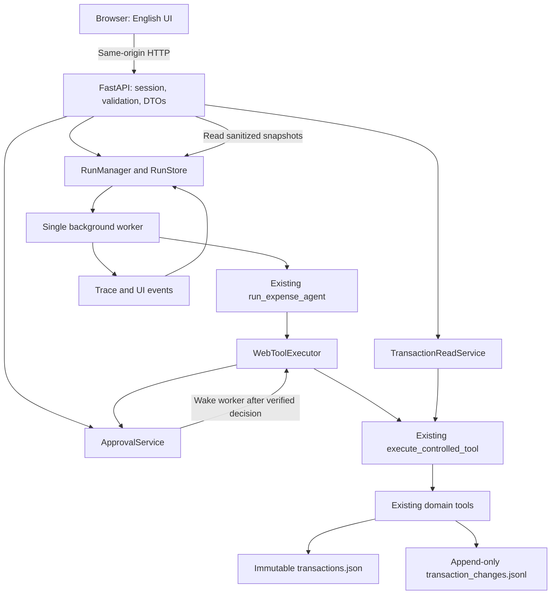
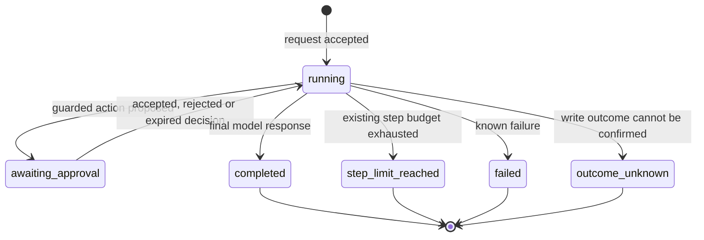
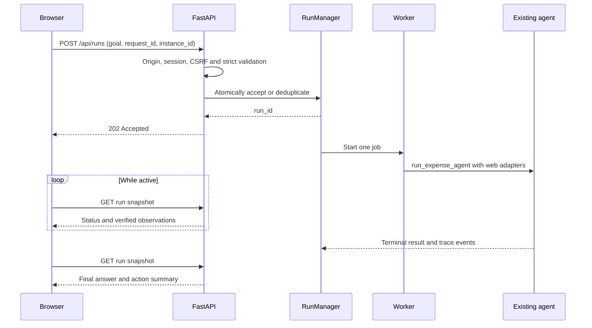
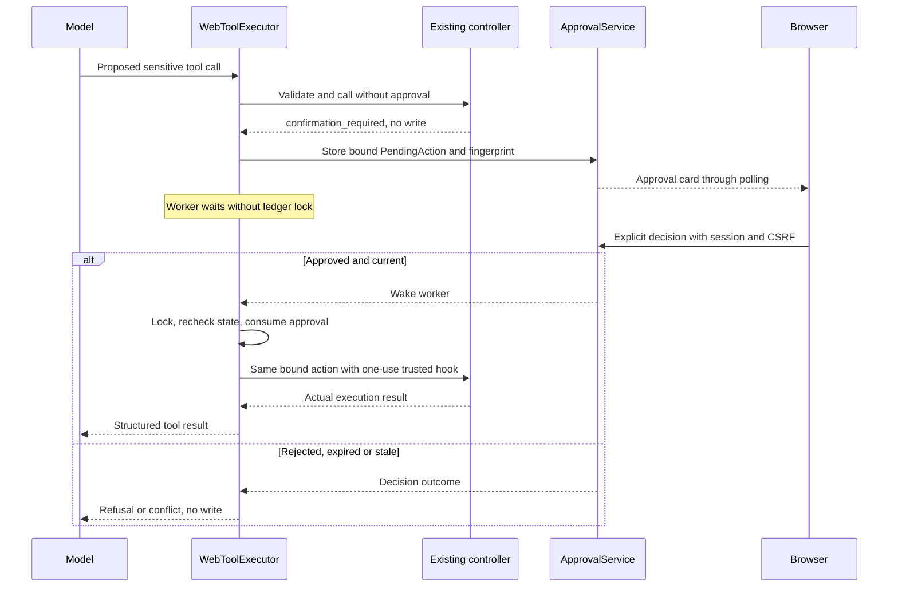

# Projekt techniczny: lokalny interfejs przeglądarkowy agenta wydatków

Status: projekt do implementacji. Dokument realizuje drugą fazę `workflow.md` na podstawie `requirements.md`; nie stanowi implementacji ani listy zadań z `tasks.md`.

Dokumentacja pozostaje po polsku, natomiast interfejs, jego etykiety, komunikaty i pytania potwierdzające będą po angielsku. Domyślny język odpowiedzi modelu w przebiegach UI to angielski, z możliwością respektowania jawnej prośby użytkownika o inny język.

## Zakres i decyzje

- **Zakres P0:** Lokalny dostęp, polecenie dla agenta, status i wynik, lista i szczegóły transakcji, kontrolowane decyzje, podsumowanie działań i obsługa błędów.
- **Zakres P1:** Rozbudowany podgląd śladu oraz ręczne przypisanie i cofnięcie kategorii pozostają poza pierwszą implementacją. Projekt pozostawia dla nich punkty rozszerzenia, ale nie wymaga dodatkowych ekranów ani endpointów.
- **Backend:** FastAPI i Uvicorn, jeden proces serwera, jeden wykonawca przebiegów. FastAPI wykorzystuje Pydantic już obecny w projekcie.
- **Frontend:** Statyczne HTML, CSS i moduły JavaScript, serwowane przez ten sam backend. Bez React, Node.js, bundlera, CDN i zewnętrznych fontów w MVP.
- **Aktualizacja stanu:** Polling JSON co 1 sekundę podczas aktywnego przebiegu; bez SSE, WebSocketów i strumieniowania tokenów w MVP.
- **Dane:** Istniejący bazowy JSON i append-only ledger, bez nowej bazy transakcyjnej. Stan sesji, przebiegów i oczekujących decyzji jest w pamięci procesu.
- **Wywołanie domeny:** Bezpośrednia integracja z Pythonem i istniejącym kontrolerem. Przeglądarka nie łączy się z MCP ani z serwerem modelu; stdio MCP zachowuje dotychczasową rolę.

FastAPI i Uvicorn będą nowymi zależnościami. Ich zgodne wersje oraz aktualizacja `uv.lock` zostaną ustalone podczas implementacji; ten dokument nie zakłada, że są już zainstalowane. Do testów HTTP należy jawnie zadeklarować potrzebną zależność testową, zamiast opierać się na przypadkowej zależności przechodniej.

## Architektura



### Organizacja modułów

Proponowane nowe elementy:

```text
src/agent_project/
  web/
    __init__.py
    __main__.py          # lokalny start Uvicorn
    app.py               # aplikacja i middleware
    schemas.py           # ścisłe modele żądań i odpowiedzi
    sessions.py          # sesja przeglądarki i CSRF
    runs.py              # RunManager, RunStore i kolejka wykonawcza
    approvals.py         # oczekujące akcje i jednorazowe decyzje
    tool_executor.py     # adaptacja wywołań dla UI
    transactions.py      # odczyty przez wspólny kontroler
    presentation.py      # angielskie komunikaty i bezpieczne DTO
    static/
      index.html
      styles.css
      app.js
  state_lock.py          # wspólna, reentrantna blokada ledgera
```

Podział jest propozycją odpowiedzialności, nie nakazem tworzenia pustych modułów. Zmiany w istniejących `agent.py` i `tools.py` mają ograniczyć się do punktów integracyjnych i wspólnej ochrony stanu; nie należy przepisywać pętli ani algorytmów domenowych.

### Rozszerzenia istniejącej pętli

Obecne `run_expense_agent` jest synchroniczne i wywołuje kontroler bezpośrednio. Obecny `confirmation_handler` dotyczy usuwania, ale nie rozwiązuje osobno autoryzacji nadpisania kategorii ani publikacji stanu UI.

Projekt przewiduje opcjonalne parametry:

- **`tool_executor`:** Wykonawca przyjmujący nazwę, surowe argumenty oraz kontekst `step` i `tool_call_id`. Bez niego pętla zachowuje dotychczasowe wywołanie kontrolera.
- **`on_event`:** Odbiorca ustrukturyzowanych zdarzeń dla RunStore. Zdarzenie zapisuje się do JSONL i publikuje do UI ze wspólnego miejsca, bez kopiowania pętli i bez odczytywania częściowo zapisanych linii pliku.
- **`response_language`:** Opcjonalna preferencja języka dodawana do promptu dla danego przebiegu. Web ustawia `en`; brak parametru zachowuje dotychczasowe zachowanie CLI i demonstracji.

Dokładne typy callbacków należy opisać w kodzie. Istniejące argumenty i wyniki funkcji pozostają zgodne, a globalny `SYSTEM_PROMPT` nie jest mutowany między wywołaniami. Wewnętrzne zdarzenie do RunStore nie może zawierać sekretu zatwierdzenia.

## Widok przeglądarkowy

Jeden ekran, bez routingu aplikacji frontendowej:

- **Nagłówek:** `Household Expense Checker` i stan usługi UI. Otwarcie strony nie uruchamia sprawdzania modelu wymagającego generowania odpowiedzi.
- **Polecenie:** Pole `What would you like to review?`, przycisk `Run analysis` i przykładowe polecenie po angielsku. Polecenie użytkownika jest traktowane jak tekst.
- **Przebieg:** Identyfikator i status: `Running`, `Waiting for your decision`, `Completed`, `Step limit reached`, `Failed` albo `Outcome unknown`.
- **Decyzja:** Oddzielna karta pokazująca akcję, transakcję i jej dane, powód, termin ważności oraz przyciski `Confirm deletion` lub `Confirm overwrite` i `Reject`.
- **Wynik:** Odpowiedź modelu i podsumowanie rzeczywistych wyników narzędzi. Statusów działania nie wyprowadza się z tekstu modelu.
- **Transakcje:** Lista z filtrem frazy i sprzedawcy oraz rozwijanymi szczegółami. Kwota zawiera walutę, a brak kategorii jest pokazany jako `Uncategorized`.

Tekst modelu jest wyświetlany przez `textContent` z zachowaniem białych znaków i czytelnym łamaniem linii. MVP nie interpretuje HTML ani Markdown jako aktywnej zawartości; listy i identyfikatory pozostają czytelne bez dodatkowego renderera.

UI przechowuje jedynie identyfikator ostatniego przebiegu w `sessionStorage`. Sekrety, akceptacje i argumenty autoryzacyjne nie trafiają do `localStorage`, adresu URL ani promptu. Po odświeżeniu pobierany jest stan backendu; zapisane polecenie nie jest automatycznie wysyłane ponownie.

## Stan i kontrakty

### Modele aplikacyjne

| Model | Najważniejsze pola | Znaczenie |
| --- | --- | --- |
| `BrowserSession` | wewnętrzny identyfikator, token CSRF, czas aktywności | Właściciel przebiegów i decyzji; bez kont użytkowników. |
| `Run` | `run_id`, właściciel, status, wersja, cel, czas, wynik, podsumowanie narzędzi, referencja śladu | Serwer jest źródłem prawdy o przebiegu. |
| `PendingAction` | `approval_id`, `run_id`, `tool_call_id`, właściciel, typ, zwalidowane argumenty, fingerprint stanu, termin ważności, status, wynik | Decyzja dotyczy konkretnego wywołania i parametrów. |
| `ToolObservation` | kolejność, krok, narzędzie, domenowy status, bezpieczne dane, `action_id` | Podsumowanie rzeczywistych skutków. |
| `RequestReceipt` | właściciel, klucz idempotencji, hash żądania, wynik przyjęcia | Deduplikacja żądań rozpoczęcia przebiegu. |

`approval_id` jest nowym losowym identyfikatorem dla pojedynczej propozycji. Domena może zwracać powtarzalny `pending_del_<transaction_id>`; ten `action_id` jest informacją prezentacyjną i nie jest samodzielnym poświadczeniem zgody.

RunStore jest ograniczony: zachowuje maksymalnie 100 ostatnich zakończonych przebiegów i maksymalnie 24 godziny historii w pamięci, nigdy nie usuwa aktywnego przebiegu. Potwierdzenie oczekuje maksymalnie 10 minut. Usunięcie pamięci po restarcie nie usuwa ledgera ani śladów.

Klucze idempotencji i przyjęte decyzje pozostają dostępne co najmniej tak długo jak ich przebiegi. Żądania zapisu zawierają identyfikator bieżącej instancji serwera; po restarcie stare żądanie jest odrzucane zamiast wykonane jako nowe.

### Stany przebiegu



Odmowa jest wynikiem narzędzia przekazanym do modelu, nie sukcesem usunięcia ani koniecznie błędem całej analizy. Restart kończy dostęp do pamięci dawnych przebiegów; backend nie wznawia ich automatycznie.

### API tego samego origin

| Metoda i ścieżka | Przeznaczenie | Główne ograniczenia |
| --- | --- | --- |
| `GET /` | Statyczny ekran aplikacji | Bez uruchamiania modelu i operacji domenowych. |
| `GET /api/session` | Bootstrap sesji, CSRF, `instance_id`, identyfikator aktywnego przebiegu | `Cache-Control: no-store`; bez sekretów konfiguracji modelu. |
| `POST /api/runs` | Start z `{goal, request_id, instance_id}` | Niepuste polecenie, maks. 8000 znaków; deduplikacja, jedna aktywna analiza. |
| `GET /api/runs/{run_id}` | Snapshot stanu, wyniku i podsumowania | Własność sesji; brak surowych ścieżek i sekretów. |
| `GET /api/runs/{run_id}/approvals` | Oczekujące karty decyzji | Zwraca dane prezentacyjne, nie ukryte uprawnienia ani parametry do podmiany. |
| `POST /api/runs/{run_id}/approvals/{approval_id}` | `{decision: approve\|reject, instance_id}` | Właściciel, CSRF, origin, TTL, stan i jednorazowe zużycie. |
| `GET /api/transactions` | Odczyt z `query`, `merchant`, `limit` | Typy i granice zgodne z `SearchTransactionsArgs`, limit 1–50. |
| `GET /api/transactions/{transaction_id}` | Szczegóły transakcji | Odczyt efektywnego stanu przez kontroler. |

Nie powstaje ogólny endpoint pozwalający przeglądarce wywołać dowolne narzędzie z dowolnymi argumentami. Endpoint decyzji nie przyjmuje `confirmed`, `force_override`, nazwy narzędzia, celu ani nowej kategorii.

Odpowiedź na przyjęcie analizy: HTTP 202 i `{run_id, status, version}`. Powtórzenie tego samego `request_id` z tym samym celem zwraca ten sam przebieg; podmiana celu z tym samym kluczem zwraca 409. Drugi, inny przebieg podczas zajętości zwraca 409 `run_in_progress` bez tworzenia kolejki.

Snapshot może zawierać pole `approval_outcome`, ale status `Completed` dotyczy ukończenia analizy, a nie zatwierdzenia każdej proponowanej operacji. Zgoda zaakceptowana przez HTTP nie jest jeszcze dowodem wykonania: wynik zapisu pochodzi z kontrolera i jest dostępny przez polling.

Zabezpieczenia i identyfikator instancji obowiązują wszystkie endpointy zmieniające stan. Żądania wykorzystują ścisłe modele Pydantic z zakazem dodatkowych pól.

Parametry query HTTP są tekstowe z natury transportu. Adapter odczytu jawnie parsuje poprawny zapis całkowity `limit` do liczby przed wspólną walidacją Pydantic; nie stosuje tego wyjątku do argumentów JSON modelu ani body żądań, gdzie zachowana jest ścisła kontrola typów.

### Odczyt i ograniczenie listy

`TransactionReadService` wywołuje `execute_controlled_tool("search_transactions", ...)` i odpowiednio narzędzie szczegółów. Nie używa modelu.

Backend pobiera dane do limitu 50 i zwraca metadane `limit` oraz `possibly_truncated`. Gdy liczba wyników osiąga limit, UI pokazuje `Showing up to 50 results. Refine your search.`; nie podaje wymyślonej liczby wszystkich rekordów. Paginacja i dodatkowe sortowanie są poza MVP.

## Wykonanie i współbieżność

### Jeden worker, responsywne HTTP

`RunManager` przyjmuje analizę atomowo i przekazuje synchroniczne `run_expense_agent` do dedykowanego `ThreadPoolExecutor(max_workers=1)`. Generowanie modelu i oczekiwanie na decyzję nigdy nie blokują pętli obsługi HTTP.

Gdy worker czeka na decyzję, zachowuje slot aktywnego przebiegu, ale nie blokadę ledgera. HTTP może wtedy odczytać dane i przyjąć decyzję. Polling kończy się po statusie terminalnym, a przy utracie połączenia używa ponowień wyłącznie odczytu z rosnącym odstępem, maksymalnie 10 sekund.

Budżet kroków pozostaje zgodny z istniejącym limitem domyślnym 12. Timeout pojedynczego wywołania modelu zachowuje istniejącą konfigurację klienta; oczekiwanie na UI ma oddzielny TTL decyzji i nie jest traktowane jak timeout sieci modelu.

### Wspólny stan i blokady

Dotychczasowe narzędzia nie zapewniają kompletnej synchronizacji wieloprocesowej. Projekt dodaje wspólny, reentrantny `LedgerGuard` oparty na blokadzie wątku oraz blokadzie pliku dla wspieranego środowiska macOS/Linux.

- **Zakres krytyczny:** Odczyt stanu, walidacja warunków i dopisanie zdarzenia muszą być jedną sekcją krytyczną. Zablokowanie samego `append_change` nie wystarcza.
- **Wspólne ścieżki:** Funkcje domenowe zapisujące stan oraz odczyty efektywnego stanu używają tej samej blokady dla danego ledgera. Zachowują swoje sygnatury i logikę; CLI i MCP korzystają z tej ochrony również bez UI.
- **Reentrancja:** Wywołanie kontrolera pod blokadą przez WebToolExecutor może wejść do blokowanego narzędzia bez zakleszczenia. Implementacja nie może otwierać niezależnej, konkurującej blokady w każdym zagnieżdżonym wywołaniu.
- **Rozdzielenie oczekiwania:** Nie wolno trzymać blokady ledgera podczas zapytania do modelu ani oczekiwania na użytkownika.
- **Instancja web:** Dodatkowa blokada startowa zapobiega uruchomieniu dwóch serwerów web dla tego samego zbioru i dwóch niezależnych RunStore. Uvicorn działa z jednym workerem i bez automatycznego reloadu w normalnym trybie.

Pliki blokad znajdują się obok właściwego ledgera; ich nazwy nie pochodzą z żądania HTTP. Gdy nie można uzyskać blokady w krótkim, ograniczonym czasie, operacja zwraca `state_busy`, a nie zaczyna równoległego zapisu.

Zewnętrzne, ręczne edytowanie ledgera nie jest wspieranym sposobem współpracy. Nieczytelny lub niepełny ledger powoduje stan wymagający sprawdzenia, zamiast wyświetlenia fałszywego sukcesu.

## Potwierdzenia i ochrona nadpisania

### Propozycja usunięcia

WebToolExecutor najpierw wywołuje istniejący kontroler bez hooka zgody. Poprawna próba usunięcia zwraca `confirmation_required` i nie zmienia stanu.

Pod blokadą zapisuje się serwerowy PendingAction: zwalidowane argumenty z `confirmed=False`, kontekst wywołania, dane do karty oraz fingerprint bazowego pliku, aktualnej transakcji i wersji ledgera. Po zwolnieniu blokady publikuje się `awaiting_approval`; worker czeka na obiekt synchronizacyjny, nie na kolejne zapytanie modelu.

HTTP zatwierdzenia weryfikuje sesję, origin, CSRF, instancję, identyfikator, TTL i stan propozycji. Parametry wykonania odczytuje tylko z PendingAction. Przyjęta decyzja budzi workera.

Worker ponownie uzyskuje blokadę ledgera, sprawdza fingerprint i atomowo przechodzi z zatwierdzonej propozycji do wykonywania. Wywołuje kontroler z hookiem, który zwraca literalne `True` wyłącznie dla tej jednej, powiązanej akcji i zgodnych argumentów. Rzeczywisty wynik kontrolera zamyka decyzję i trafia do modelu oraz RunStore.

Ponowne zatwierdzenie nie wykonuje funkcji drugi raz: zwraca zapisany stan `executing` lub wynik. Zmiana danych od czasu propozycji unieważnia decyzję jako `stale`; potrzebna jest nowa propozycja i nowa zgoda.

### Nadpisanie kategorii

Modelowe `force_override=True` jest propozycją, nie uprawnieniem. WebToolExecutor najpierw waliduje argumenty tym samym modelem co kontroler i sprawdza próbę bez wymuszenia.

- **Brak kategorii:** Normalne przypisanie przechodzi przez kontroler, bez dodawania niepotrzebnej decyzji.
- **Istniejąca identyczna kategoria:** Wraca `already_assigned`, bez dodatkowego zapisu.
- **Istniejąca inna kategoria, brak propozycji wymuszenia:** Wraca `already_assigned`; model może zmienić dalsze działanie.
- **Istniejąca inna kategoria, propozycja wymuszenia:** Powstaje PendingAction typu `overwrite_category`, pokazujący stare i nowe wartości. Dopiero serwerowo zweryfikowana zgoda pozwala wywołać kontroler z `force_override=True`.

Nie zmienia to domyślnego kontraktu narzędzia dla CLI/MCP. Jest dodatkową polityką ścieżki web, wymaganą przez AC-22.

### Odmowa, wygaśnięcie i niepewny wynik

Odmowa lub TTL zamyka propozycję bez zapisu i przekazuje modelowi ustrukturyzowaną obserwację odmowy zgodną z polityką web. Rozróżnienie `rejected` i `expired` jest zachowane w RunStore, nawet jeśli komunikat narzędziowy używa `confirmation_denied`.

Jeśli błąd zapisu nastąpił po rozpoczęciu dopisywania i nie da się ustalić skutku, stan to `outcome_unknown`. Taki wynik nie jest automatycznie ponawiany. Po restarcie brak starego PendingAction nigdy nie uprawnia do odtworzenia zgody ani powtórzenia zapisu; UI informuje o utracie kontekstu i udostępnia odczyt bieżących transakcji.

## Diagramy sekwencji

### Analiza i wynik



### Jednorazowa decyzja



## Bezpieczeństwo i język interfejsu

- **Nasłuch:** Domyślnie `127.0.0.1:8765`. Brak konfiguracji domyślnie otwierającej `0.0.0.0`, tunelu lub LAN.
- **Host i origin:** Dozwolony jest skonfigurowany lokalny host i port. Middleware odrzuca nieoczekiwany Host, chroniąc także przed DNS rebinding. Modyfikujące żądania wymagają dokładnego Origin; brak lub `null` nie jest akceptowany.
- **Sesja:** Losowy cookie `HttpOnly`, `SameSite=Strict`, ścieżka `/`. Dla domyślnego lokalnego HTTP nie deklaruje się nieprawdziwej ochrony Secure; HTTPS i zdalny dostęp są poza MVP.
- **CSRF:** Losowy token bootstrapu dostępny tylko dla tego origin, wysyłany w dedykowanym nagłówku. Nie jest argumentem narzędzia ani elementem historii modelu.
- **CORS i format:** Brak cross-origin CORS. Zmiany tylko przez JSON i niebezpieczne metody HTTP zabezpieczone jak wyżej; żaden GET nie wykonuje analizy ani zapisu domenowego.
- **Treść:** Wyłącznie bezpieczny tekst, brak `innerHTML` dla modelu i danych. CSP ogranicza zasoby i połączenia do własnego origin, blokuje osadzanie strony oraz zewnętrzne skrypty.
- **Poufność:** Backend nie zwraca `.env`, kluczy, surowych wyjątków, dowolnych ścieżek plików ani nie udostępnia katalogu projektu jako static root. Statyczny jest tylko katalog `web/static`.
- **Język:** Katalog komunikatów prezentacyjnych jest angielski. Statusy, np. `already_assigned`, otrzymują bezpieczny opis `This transaction already has a category.`; oryginalnych danych sprzedawcy i identyfikatorów się nie tłumaczy.
- **Odpowiedź modelu:** Preferencja `en` obowiązuje tylko przebiegi UI; nie gwarantuje się wymuszenia języka dowolnego tekstu modelu ani nie dodaje osobnego wywołania tłumaczącego. Zaufane pytania i błędy UI zawsze pochodzą z angielskiego katalogu, a nie z modelu.

Sesja lokalna nie zastępuje logowania dla Internetu. Przyszłe otwarcie dostępu z innych urządzeń wymaga odrębnego projektu bezpieczeństwa.

## Błędy i obserwowalność

| Przypadek | Zachowanie API/UI | Ponowienie |
| --- | --- | --- |
| Puste lub błędne żądanie | 422, angielski błąd pola | Dopiero po poprawieniu danych. |
| Inny aktywny przebieg lub ten sam klucz z inną treścią | 409 | Bez automatycznego tworzenia kolejnego zadania. |
| Błędna sesja, CSRF lub origin | 403 | Bez wykonania operacji. |
| Nieznany lub utracony przebieg | 404 z bezpiecznym `run_unavailable` | Odczyt danych możliwy; brak automatycznego odtworzenia. |
| Wygasła, nieaktualna lub zużyta decyzja | Wynik bieżącej decyzji albo 409 | Nigdy ponowne wykonanie na podstawie starej zgody. |
| Model niedostępny lub timeout | Przebieg `failed`, np. `Local model is unavailable.` | Tylko jawna nowa analiza. |
| Limit kroków | `step_limit_reached`, zachowane obserwacje | Bez automatycznego kontynuowania. |
| `not_found`, `already_assigned`, `state_conflict` | Jawny wynik narzędzia i angielski opis | Nie zamieniać na sukces zapisu ani ogólny błąd HTTP analizy. |
| Niepewny zapis lub niespójny ledger | `outcome_unknown`, komunikat wymagający sprawdzenia | Brak automatycznego zapisu ponownego. |

Ślady UI trafiają do nowego `traces/web_<run_id>.jsonl`, a nie do istniejącego `evidence/trace_multitool_adaptation.jsonl`. Rejestruje się rozpoczęcie, odpowiedzi modelu, obserwacje, wystawienie i rozstrzygnięcie decyzji oraz wynik końcowy, bez cookie, CSRF i sekretów.

Log błędu otrzymuje identyfikator korelacyjny. Publiczny DTO zawiera kod i komunikat z katalogu; surowy tekst wyjątku kontrolera nie trafia bezpośrednio do przeglądarki. Utrata połączenia z UI nie anuluje ani nie powtarza operacji domenowej.

## Strategia testowania i pokrycie

### Testy deterministyczne

- **Sesja i API:** Bootstrap, Host/Origin/CSRF, dodatkowe pola, limit polecenia, brak sekretów i brak zapisu przy GET. Pokrycie AC-01–AC-06, AC-18 i NFR-03–NFR-05.
- **RunManager:** Podwójne wysłanie, dwie karty, odświeżenie, jeden slot, limit kroków, timeout, nieznany status po restarcie i brak automatycznych ponowień. Pokrycie AC-07–AC-10, AC-24–AC-26.
- **Odczyty:** Zgodność z kontrolerem i ledgerem, szczegóły, brak wyników, limit i brak modelu w odczycie. Pokrycie AC-11–AC-14.
- **Decyzje:** Akceptacja, odmowa, TTL, brak kontekstu, podmiana celu, obca sesja, ponowne użycie i zmiana stanu między decyzją a zapisem. Pokrycie AC-15–AC-19.
- **Nadpisanie:** Modelowe `force_override=True` bez kliknięcia nie zmienia danych; zatwierdzenie wykonuje jeden zapis; ta sama kategoria nie tworzy zbędnego zdarzenia. Pokrycie AC-22.
- **Prezentacja skutków:** Rozbieżność między deklaracją modelu a statusem narzędzia, odświeżenie efektywnego stanu, brak niepotwierdzonych zmian optymistycznych. Pokrycie AC-20–AC-23.
- **Blokady:** Dwa procesy testowe i dwa wątki nie mogą ominąć walidacji przez równoległy zapis; oczekiwanie na decyzję nie blokuje odczytów ani HTTP. Pokrycie AC-25, NFR-01–NFR-02.
- **Język i treść:** Angielskie etykiety, błędy i karty, niezinterpretowany HTML/skrypt, niezmienione nazwy sprzedawców, preferencja języka tylko dla UI. Pokrycie NFR-04, NFR-10.

Model w testach jest stubem lub `MockClient`; zegar TTL jest kontrolowany przez fixture, bez dziesięciominutowego oczekiwania. Wszystkie zapisy używają tymczasowych danych, z kontrolą hasha bazowego pliku.

### Testy przeglądarkowe i regresja

Nowe testy przeglądarkowe z lokalnym backendem i stubem modelu sprawdzają pełny przebieg, odmowę i zgodę, double-click, przeładowanie, utratę połączenia, klawiaturę oraz szerokość 360 px. Zależność i instalacja przeglądarki testowej są częścią przyszłej implementacji, nie warunkiem otwarcia samego UI.

Stan oczekiwania ma pojawić się w ciągu 1 sekundy od odpowiedzi backendu, zgodnie z NFR-07. Nie mierzy się w tym kryterium czasu inferencji modelu.

Dotychczasowe testy CLI, MCP, demonstracji i domeny muszą nadal przechodzić, wraz z Ruff. W momencie przygotowania projektu ostatnia weryfikacja obejmowała 147 testów; liczba ta jest punktem odniesienia, nie docelowym limitem.

Na końcu wykonuje się osobny, kontrolowany przebieg z lokalnym modelem i UI na danych testowych: dwa narzędzia, reakcja na obserwację, odmowa bez zapisu oraz osobny scenariusz jednej zatwierdzonej operacji. Wyniki nie nadpisują śladu demonstracji wielonarzędziowej.

### Macierz wymagań niefunkcjonalnych

| Wymaganie | Odpowiedź projektowa |
| --- | --- |
| NFR-01 | Kontroler i domena współdzielone; opcjonalne adaptery zamiast nowej pętli. |
| NFR-02 | LedgerGuard, append-only, brak przepisywania baseline i testy hasha. |
| NFR-03 | Loopback, lokalny model, zasoby własne i sekrety wyłącznie na serwerze. |
| NFR-04 | `textContent`, restrykcyjna CSP i testy niezaufanej treści. |
| NFR-05 | Sesja, CSRF, Origin, Host i zamknięte endpointy zamiast dowolnego wywołania narzędzi. |
| NFR-06 | Etykiety i focus, dostęp klawiaturą, tekstowe statusy oraz układ 360 px. |
| NFR-07 | Jeden worker poza HTTP, polling i natychmiastowy stan przyjęcia. |
| NFR-08 | Domyślne dotychczasowe ścieżki wykonania oraz pełna regresja CLI/MCP. |
| NFR-09 | Jeden udokumentowany start lokalny i brak automatycznej analizy przy otwarciu strony. |
| NFR-10 | Angielski katalog komunikatów, bez tłumaczenia danych i technicznych identyfikatorów. |

## Uruchomienie, ograniczenia i dalsza faza

Docelowe polecenie po implementacji:

```bash
uv run python -m agent_project.web
```

Proces poda `http://127.0.0.1:8765`; zatrzymanie nastąpi przez Ctrl+C. Zamykanie unieważnia oczekujące decyzje i nie odtwarza automatycznie zadań po ponownym starcie. Jest to polecenie projektowane, a nie obecnie dostępny entry point.

- **Ograniczenie pamięci:** Historia UI nie jest trwałą historią rozmów. Po restarcie pozostają dane domenowe i ślady, ale nie prawa do wykonania dawnych decyzji.
- **Ograniczenie wykonania:** Brak przycisku anulowania długiej inferencji w MVP. UI pokazuje pracę i obsługuje timeout, bez obietnicy natychmiastowego przerwania klienta synchronicznego.
- **Ryzyko integracji:** Wyodrębnienie callbacków musi zachować kolejność wiadomości narzędziowych i liczenie kroków. Testy kontraktowe chronią przebieg demonstracji wielonarzędziowej.
- **Ryzyko bezpieczeństwa:** Najważniejsze testy dotyczą powiązania zgody, czasu walidacji wobec zapisu i ponowienia po utracie odpowiedzi; same przyciski i same promptowe zakazy nie zapewniają ochrony.
- **Decyzje P1:** Nie włącza się ich do implementacji bez rozszerzenia zakresu. OQ-01 z wymagań rozstrzyga ten projekt wyborem FastAPI i statycznego frontendu; OQ-02 i OQ-03 pozostają poza MVP.

Kolejną fazą procesu będzie `tasks.md` z odniesieniami do US, AC i NFR. Plan narzędzi i integracji MCP jest w `PLAN.md`.
