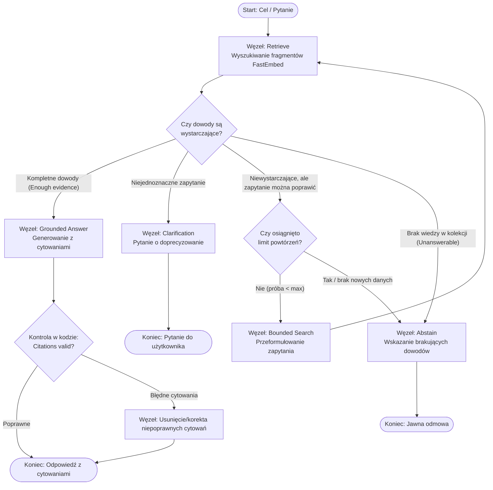

# Plan wdrożenia stanowego grafu RAG

Ukończono zadania T-L3-01–T-L3-14 i zweryfikowano kryteria akceptacji.

---

## 1. Cel i zakres

Celem zadania jest budowa stanowego, opartego na grafie wykonania (**LangGraph**) przepływu RAG z weryfikowalnymi cytowaniami oraz jawną odmową odpowiedzi (**abstention**), gdy w dokumentach brak wystarczających dowodów.

### Wymagania kluczowe
1. **Dokumenty domenowe:** zbiór dokumentów powiązanych z domeną projektu (polityki budżetowe, zasady kategoryzacji wydatków, umowy/taryfy mediów, regulaminy subskrypcji).
2. **Chunking i metadane:** podział na przeszukiwalne fragmenty z zachowaniem źródła (`source`) i nagłówka/pozycji dla każdego chunka.
3. **Lokalne embeddingi (FastEmbed):** lokalny model wektorowy z pamięcią podręczną w `.cache/` (rozmiar modelu ~65 MB, brak kosztów i połączeń chmurowych).
4. **Graf wykonania LangGraph:** jawny graf stanowy (StateGraph) zamiast jednej liniowej funkcji, z obsługą pętli i rozgałęzień decyzyjnych.
5. **Decyzje grafu (The Required Decision):**
   - *Dowody kompletne:* odpowiedź z potwierdzonymi cytowaniami (*Grounded answer with verified citations*).
   - *Lepsze zapytanie może pomóc:* powtórne, ograniczone wyszukiwanie (*Search once more / Bounded search*).
   - *Niejednoznaczna intencja:* pytanie doprecyzowujące do użytkownika (*Ask for clarification*).
   - *Brak wiedzy w kolekcji:* odmowa odpowiedzi ze wskazaniem, jakich informacji brakuje (*Abstain and name what is missing*).
6. **Programowa weryfikacja cytowań (Code-enforced citations):** twardy warunek w kodzie Pythona sprawdzający, czy cytowane w odpowiedzi źródła rzeczywiście znajdowały się w pobranych fragmentach (ochrona przed halucynacjami źródeł).
7. **Zestaw ewaluacyjny (Evaluation Set):** minimum 10 pytań ewaluacyjnych (w tym co najmniej 3 celowo bez odpowiedzi / unanswerable).
8. **Rozdzielenie metryk:** osobna ocena jakości retrieval (wyszukiwania) oraz jakości odpowiedzi (generowania) + analiza co najmniej jednego błędu (failure analysis).

---

## 2. Architektura grafu stanowego (Execution Graph)

---

## 3. Plan zadań wdrożeniowych

### Faza 1: Baza wiedzy, chunking i lokalny indeks FastEmbed

- [x] **T-L3-01: Przygotowanie dokumentów domenowych projektu.**
  - **Status:** ukończone.
  - **Zakres:** Utworzyć folder `data/documents/` zawierający 4–6 ustrukturyzowanych dokumentów Markdown/tekstowych związanych z budżetem domowym i wydatkami:
    1. `household_budget_policy.md` (limity wydatków, progi ostrzegawcze, definicje kategorii).
    2. `subscriptions_policy.md` (zasady anulowania, audyt subskrypcji, wykrywanie duplikatów).
    3. `utility_contracts_faq.md` (taryfy prądu i gazu, terminy płatności, odsetki).
    4. `warranties_and_receipts.md` (zasady archiwizacji paragonów, okresy rękojmi i gwarancji sprzętu AGD/RTV).
  - **Weryfikacja:** Dokumenty zawierają fakty i liczby pozwalające na weryfikację pytań szczegółowych oraz celowe luki dla pytań bez odpowiedzi.
  - **Implementacja:** Utworzono 4 spójne dokumenty w `data/documents/` ściśle powiązane z encjami i transakcjami z `data/transactions.json` (Lidl/Biedronka, Spotify, PGE Dystrybucja, Orlen, Carrefour). Dokumenty zawierają twarde dane (limity, stawki, terminy, zasady postępowania z duplikatami) oraz celowe luki tematyczne (np. brak zasad dla kryptowalut, fotowoltaiki, zwierząt domowych) na potrzeby pytań bez odpowiedzi (unanswerable).
  - **Wynik weryfikacji:** Wszystkie pliki utworzone, poprawnie sformatowane w Markdown; istniejące testy (498 passed) i Ruff check przechodzą bez błędów.
  - **Blokady:** brak. Nie rozpoczęto T-L3-02 ("i zakończ").

- [x] **T-L3-02: Moduł chunkingu i metadanych fragmentów (`rag/chunking.py`).**
  - **Status:** ukończone.
  - **Zakres:** Zaimplementować deterministyczny podział dokumentów na fragmenty z zachowaniem:
    - `source`: nazwa pliku źródłowego,
    - `chunk_id`: unikalny identyfikator fragmentu,
    - `section`: nagłówek sekcji,
    - `text`: treść fragmentu (rozmiar ok. 300–500 tokenów z nakładaniem ~50 tokenów).
  - **Weryfikacja:** Test jednostkowy sprawdzający, czy każdy wygenerowany fragment ma przypisane poprawne źródło i nie gubi metadanych.
  - **Implementacja:** Utworzono pakiet `agent_project.rag` oraz moduł `chunking.py` z niemutowalnym modelem Pydantic `DocumentChunk`, estymatorem tokenów `estimate_tokens`, funkcją `split_markdown_into_chunks` (analiza nagłówków `#`, `##`, sekcji i nakładających się akapitów) oraz `load_and_chunk_documents` (deterministyczne sortowanie plików i wczytywanie).
  - **Wynik weryfikacji:** Dodano 9 testów w `tests/test_rag_chunking.py`. Pełny zestaw testów `uv run --no-sync pytest` daje 507 passed, 0 failed. `uv run ruff check .` daje *All checks passed!*.
  - **Blokady:** brak. Nie rozpoczęto T-L3-03 ("i zakończ").

- [x] **T-L3-03: Lokalny silnik embeddingów FastEmbed i pamięć podręczna (`rag/embeddings.py`).**
  - **Status:** ukończone.
  - **Zakres:** 
    - Zintegrować bibliotekę `fastembed` (model domyślny `BAAI/bge-small-en-v1.5` o rozmiarze ~65 MB).
    - Skonfigurować katalog cache na `.cache/fastembed` wewnątrz projektu (zgodnie z wymogiem uniknięcia ponownego pobierania i zużycia API).
    - Zaimplementować funkcję tworzenia wektorów i indeksowania fragmentów.
  - **Weryfikacja:** Test sprawdzający, że po pierwszym pobraniu kolejne generowanie embeddingów działa w 100% offline bez odpytywania sieci.
  - **Implementacja:** Zainstalowano `fastembed>=0.9.1`, zaimplementowano klasę `LocalEmbeddingEngine` w `rag/embeddings.py` z domyślnym modelem `BAAI/bge-small-en-v1.5` i pamięcią podręczną w `.cache/fastembed/`. Zaimplementowano metody `embed_texts`, `embed_query` oraz `embed_chunks` (generowanie wektorów 384-wymiarowych dla `DocumentChunk`).
  - **Wynik weryfikacji:** Dodano 6 testów w `tests/test_rag_embeddings.py` (sprawdzających wymiary wektorów, normalizację, ranking podobieństwa semantycznego oraz działanie 100% offline przy zablokowanym połączeniu sieciowym). Pełny zestaw testów `uv run --no-sync pytest` daje 513 passed, 0 failed. `uv run ruff check .` daje *All checks passed!*.
  - **Blokady:** brak. Nie rozpoczęto T-L3-04 ("i zakończ").

- [x] **T-L3-04: Wyszukiwanie wektorowe i funkcja search (`rag/vector_store.py`).**
  - **Status:** ukończone.
  - **Zakres:** Zaimplementować prosty, lekki magazyn wektorowy (oparty na macierzy cosinusowej / numpy) z funkcją `search(query, top_k=3, score_threshold=0.5)` zwracającą listę dopasowanych fragmentów wraz ze wskaźnikiem podobieństwa i metadanymi.
  - **Weryfikacja:** Testy wyszukiwania fraz dokładnych, semantycznych oraz zapytań niepasujących (zwracających niski score).
  - **Implementacja:** Zaimplementowano `SearchResult` (model Pydantic ze skrótami do pól chunka i znormalizowanym scorem podobieństwa) oraz `VectorStore` w `rag/vector_store.py` (wyszukiwanie macierzowe cosine similarity przez NumPy, filtrowanie progiem odcięcia `score_threshold`, limit `top_k`, zapis/odczyt indeksu do/z pliku JSON `save`/`load` oraz fabryka `build_vector_store_from_directory`).
  - **Wynik weryfikacji:** Dodano 5 testów w `tests/test_rag_vector_store.py` (sprawdzających pusty magazyn, dodawanie i ranking, odcięcie progowe, trwałość indeksu JSON oraz wyszukiwanie na realnych dokumentach z `data/documents/`). Pełny zestaw testów `uv run --no-sync pytest` daje 518 passed, 0 failed. `uv run ruff check .` daje *All checks passed!*.
  - **Blokady:** brak. Nie rozpoczęto T-L3-05 ("i zakończ").

---

### Faza 2: Stan grafu, węzły decyzyjne i LangGraph

- [x] **T-L3-05: Definicja stanu grafu i kontraktów (`rag/state.py`).**
  - **Status:** ukończone.
  - **Zakres:** Zdefiniować `RAGState(TypedDict)`:
    - `query: str` (bieżące zapytanie użytkownika),
    - `retrieval_history: list[dict]` (historia zapytań i pobranych fragmentów),
    - `documents: list[DocumentChunk]` (aktualnie uwzględnione fragmenty),
    - `evidence_status: Literal["complete", "need_better_query", "ambiguous", "lacks_evidence"]`,
    - `retry_count: int` (licznik powtórzeń wyszukiwania, maks. 1),
    - `answer: str | None` (wygenerowana odpowiedź),
    - `citations: list[str]` (wyodrębnione cytowania ze źródeł),
    - `missing_evidence: list[str] | None` (nazwane braki w wiedzy w przypadku odmowy),
    - `clarification_question: str | None` (pytanie do użytkownika przy zapytaniu wieloznacznym).
  - **Weryfikacja:** Test walidacji stanu początkowego i przejść stanów.
  - **Implementacja:** Zainstalowano `langgraph>=1.2.20`, zaimplementowano `EvidenceStatus` (4 stany oceny dowodów), `RetrievalRecord`, `RAGState(TypedDict)` oraz funkcje pomocnicze `create_initial_state`, `record_retrieval` (aktualizacja historii i deduplikacja akumulowanych dokumentów) i `validate_rag_state` (weryfikacja spójności stanu i niezmienników).
  - **Wynik weryfikacji:** Dodano 5 testów w `tests/test_rag_state.py` (sprawdzających inicjalizację, deduplikację dokumentów, walidację niezmienników oraz pełną integrację schematu z LangGraph `StateGraph(RAGState)`). Pełny zestaw testów `uv run --no-sync pytest` daje 523 passed, 0 failed. `uv run ruff check .` daje *All checks passed!*.
  - **Blokady:** brak. Nie rozpoczęto T-L3-06 ("i zakończ").

- [x] **T-L3-06: Węzły oceny dowodów i przeformułowania (`rag/nodes/grading.py`).**
  - **Status:** ukończone.
  - **Zakres:** 
    - Węzeł `grade_evidence`: ocena, czy pobrane fragmenty wystarczają do odpowiedzi na pytanie. Rozpoznaje 4 stany z tabeli wymagań:
      1. Kompletne dowody -> `complete`.
      2. Zapytanie zbyt wąskie/niedokładne, a w kolekcji mogą być dane -> `need_better_query`.
      3. Zapytanie wieloznaczne -> `ambiguous`.
      4. Temat zupełnie nieobecny w bazie -> `lacks_evidence`.
    - Węzeł `rewrite_query` (Bounded search): generuje alternatywne sformułowanie zapytania na podstawie brakujących elementów; inkrementuje `retry_count` (maksymalnie 1 ponowienie).
  - **Weryfikacja:** Testy jednostkowe dla każdego z 4 stanów na kontrolowanych zestawach dokumentów.
  - **Implementacja:** Zaimplementowano model `EvidenceGradeResult` oraz funkcje `evaluate_evidence`, `grade_evidence_node` i `rewrite_query_node` w `rag/nodes/grading.py`. Obsłużono pełną klasyfikację 4 stanów decyzyjnych zarówno w trybie deterministycznym (wzorce unanswerable, wieloznaczności, pokrycie słów kluczowych), jak i przez prompt do `ModelClient`. Węzeł `rewrite_query_node` realizuje bounded search z inkrementacją licznika `retry_count`.
  - **Wynik weryfikacji:** Dodano 8 testów w `tests/test_rag_grading.py` (sprawdzających stany: complete, ambiguous, lacks_evidence, need_better_query, aktualizację stanu węzłów, ekspansję zapytania oraz mocki ModelClient z fallbackiem). Pełny zestaw testów `uv run --no-sync pytest` daje 531 passed, 0 failed. `uv run ruff check .` daje *All checks passed!*.
  - **Blokady:** brak. Nie rozpoczęto T-L3-07 ("i zakończ").

- [x] **T-L3-07: Węzły generowania odpowiedzi i odmowy (`rag/nodes/generation.py`).**
  - **Status:** ukończone.
  - **Zakres:**
    - Węzeł `generate_grounded_answer`: tworzy odpowiedź wyłącznie w oparciu o przekazane fragmenty, z jawnym formatem przypisów, np. `[source: filename.md#chunk_id]`.
    - Węzeł `abstain`: generuje jednoznaczny komunikat odmowy ze wskazaniem, jakich informacji brakuje w dokumentach (np. *"Brak informacji w politykach na temat limitów dla kategorii 'Kryptowaluty'"*).
    - Węzeł `clarify`: generuje pytanie uściślające intencję użytkownika.
  - **Weryfikacja:** Testy generowania odpowiedzi z poprawnymi przypisami oraz sprawdzanie formatu komunikatu odmowy.
  - **Implementacja:** Zaimplementowano funkcje `extract_citations_from_text`, `generate_grounded_answer_node`, `abstain_node` oraz `clarify_node` w `rag/nodes/generation.py` i wyeksportowano je w `rag/nodes/__init__.py`. Węzeł generowania obsługuje zarówno syntezę deterministyczną na bazie top-k fragmentów, jak i promptowanie klienta `ModelClient` z twardym wymogiem przypisów `[source: <chunk_id>]`. Węzeł odmowy precyzyjnie wymienia zidentyfikowane luki w dowodach (`missing_evidence`), a węzeł `clarify` formułuje pytanie uściślające.
  - **Wynik weryfikacji:** Dodano 7 testów w `tests/test_rag_generation.py` (sprawdzających wyodrębnianie i deduplikację cytowań, deterministyczne i modelowe generowanie odpowiedzi z przypisami, odmowę ze wskazaniem braków dowodowych oraz pytanie doprecyzowujące). Pełny zestaw testów `uv run --no-sync pytest` daje 538 passed, 0 failed. `uv run ruff check .` daje *All checks passed!*.
  - **Blokady:** brak. Nie rozpoczęto T-L3-08 ("i zakończ").

- [x] **T-L3-08: Złożenie grafu LangGraph i obsługa pętli (`rag/graph.py`).**
  - **Status:** ukończone.
  - **Zakres:**
    - Zbudować `StateGraph(RAGState)` łączący węzły: `retrieve` -> `grade_evidence` -> warunkowe rozgałęzienie (`generate_answer` / `rewrite_query` -> `retrieve` / `abstain` / `clarify`).
    - Zaimplementować ograniczenie (bounding): pętla ponownego szukania może wykonać się co najwyżej raz, chroniąc przed nieskończonym cyklem.
    - Dodać funkcję kompilacji grafu `compile_rag_graph()`.
  - **Weryfikacja:** Testy przepływu ścieżek grafu: ścieżka bezpośrednia, ścieżka z jednym ponowieniem, ścieżka natychmiastowej odmowy, ścieżka prośby o doprecyzowanie.
  - **Implementacja:** Zaimplementowano moduł `rag/nodes/retrieval.py` z węzłem `retrieve_node` oraz moduł `rag/graph.py` zawierający router `decide_next_step`, konstruktor grafu `build_rag_graph`, kompilator `compile_rag_graph` oraz funkcję wykonawczą `run_rag_pipeline`. Przepływ łączy węzły `retrieve`, `grade_evidence`, `generate_answer`, `rewrite_query`, `abstain` i `clarify`. Wprowadzono twarde ograniczenie pętli (bounding search limit: domyślnie `max_retries=1`), przekierowujące do `abstain` po wyczerpaniu budżetu ponowień.
  - **Wynik weryfikacji:** Dodano 9 testów w `tests/test_rag_graph.py` (weryfikujących router `decide_next_step`, strukturę grafu, ścieżkę bezpośrednią `complete`, bounded search z sukcesem, bounded search z wyczerpaniem limitu do `abstain`, natychmiastową odmowę dla zapytań nieobsługiwanych, doprecyzowanie `clarify`, wstrzyknięcie klienta `ModelClient` oraz pełny przebieg end-to-end na realnym `VectorStore` z `data/documents/`). Pełny zestaw testów `uv run --no-sync pytest` daje 547 passed, 0 failed. `uv run ruff check .` daje *All checks passed!*.
  - **Blokady:** brak. Nie rozpoczęto T-L3-09 ("i zakończ").

---

### Faza 3: Deterministyczna weryfikacja cytowań w kodzie

- [x] **T-L3-09: Programowa weryfikacja cytowań (`rag/citations.py`).**
  - **Status:** ukończone.
  - **Zakres:** Zaimplementować funkcję w kodzie Pythona: `verify_and_filter_citations(answer: str, retrieved_chunks: list[DocumentChunk]) -> VerificationResult`:
    - Wyodrębnia wszystkie cytowania ze znaczników w tekście odpowiedzi.
    - Sprawdza, czy każde cytowane źródło (`source` / `chunk_id`) faktycznie znajduje się w liście fragmentów dostarczonych modelowi w tym przebiegu.
    - Jeśli model zacytuje źródło, którego nie było w pobranych fragmentach (halucynacja cytowania):
      - kontroler oznacza cytowanie jako nieprawidłowe,
      - usuwa fałszywy odsyłacz lub cofa odpowiedź do poprawki/odmowy.
  - **Weryfikacja:** Testy z prawidłowo zacytowanymi źródłami, zacytowanymi źródłami zmyślonymi oraz odpowiedziami bez cytowań.
  - **Implementacja:** Zaimplementowano moduł `rag/citations.py` z modelem `VerificationResult`, funkcjami `verify_and_filter_citations`, `build_valid_identifier_set`, `_clean_invalid_citation_tags` oraz węzłem LangGraph `verify_citations_node`. Zintegrowano twardą weryfikację cytowań w `generate_grounded_answer_node`, filtrując halucynacje z modeli LLM bezpośrednio w kodzie Pythona.
  - **Wynik weryfikacji:** Dodano 8 testów w `tests/test_rag_citations.py` (sprawdzających prawidłowe cytowania, wykrywanie i usuwanie halucynacji ze stripowaniem tagów, odpowiedzi bez cytowań, całkowicie zmyślone cytowania, opcję odmowy `fallback_to_abstain`, warianty nazw i wielkości liter, węzeł LangGraph oraz automatyczną filtrację halucynacji w węźle generowania). Pełny zestaw testów `uv run --no-sync pytest` daje 555 passed, 0 failed. `uv run ruff check .` daje *All checks passed!*.
  - **Blokady:** brak. Nie rozpoczęto T-L3-10 ("i zakończ").

---

### Faza 4: Ewaluacja (10 pytań), metryki i analiza błędów

- [x] **T-L3-10: Przygotowanie zestawu ewaluacyjnego (Evaluation Benchmark).**
  - **Status:** ukończone.
  - **Zakres:** Utworzyć plik `tests/data/rag_eval_dataset.json` zawierający co najmniej 10 zapytań:
    - **7 pytań z odpowiedziami (Answerable):**
      - 4 pytania proste (jednoznaczna odpowiedź w 1 kroku),
      - 2 pytania wymagające powtórnego szukania (*bounded search / query rewrite*),
      - 1 pytanie wieloznaczne (wymagające *clarification*).
    - **3 pytania celowo bez odpowiedzi (Intentionally Unanswerable):**
      - Pytanie o nieistniejącą procedurę/kategorię w budżecie,
      - Pytanie o dostawcę mediów nieopisanego w umowach,
      - Pytanie o limit kwotowy, którego celowo nie zdefiniowano w dokumentach.
  - **Weryfikacja:** Walidacja struktury zestawu ewaluacyjnego (format JSON z polami `query`, `expected_behavior`, `relevant_sources`).
  - **Implementacja:** Utworzono benchmark ewaluacyjny `tests/data/rag_eval_dataset.json` zawierający dokładnie 10 zdefiniowanych zapytań testowych (4 proste, 2 bounded search, 1 clarify, 3 unanswerable ze wskazanymi brakami dowodowymi) powiązanych z dokumentami domenowymi z `data/documents/`. Dodano moduł `rag/eval_dataset.py` z modelem Pydantic `EvalQueryItem` oraz walidatorem/loaderem `load_evaluation_dataset`.
  - **Wynik weryfikacji:** Dodano 7 testów w `tests/test_rag_eval_dataset.py` (weryfikujących istnienie i ładowanie pliku, rozkład kategorii 7 answerable / 3 unanswerable, unikalność identyfikatorów i kompletność pól, istnienie wszystkich wskazanych dokumentów źródłowych na dysku, obecność nazwanych tematów braków dowodowych, dopasowanie retrieval w VectorStore oraz obsługę błędów ścieżki i formatu JSON). Pełny zestaw testów `uv run --no-sync pytest` daje 562 passed, 0 failed. `uv run ruff check .` daje *All checks passed!*.
  - **Blokady:** brak. Ukończono T-L3-11 ("i zakończ").

- [x] **T-L3-11: Runner ewaluacji i rozdzielenie metryk Retrieval vs Generation (`rag/evaluate.py`).**
  - **Status:** ukończone.
  - **Zakres:**
    - Zaimplementować skrypt uruchamiający ewaluację na 10 pytaniach.
    - **Metryki Retrieval (niezależne od LLM):**
      - Hit Rate / Recall@k (czy właściwy fragment znalazł się w top_k),
      - Precision fragmentów.
    - **Metryki Answer Generation:**
      - Poprawność merytoryczna odpowiedzi,
      - Citation Precision (odsetek poprawnych cytowań),
      - Prawidłowość odmowy (czy model odmówił w 3/3 pytań unanswerable).
    - Generowanie raportu `evidence/rag_evaluation_report.md`.
  - **Implementacja:** Utworzono moduł `src/agent_project/rag/evaluate.py` z modelami Pydantic `RetrievalMetrics`, `GenerationMetrics`, `QueryEvaluationResult`, `EvaluationReport` oraz funkcjami `evaluate_single_query`, `compute_aggregate_metrics`, `generate_markdown_report` i runnerem CLI `run_rag_evaluation` / `main()`. Moduł przeprowadza ewaluację na 10 pytaniach benchmarkowych z decoupled metrics oraz generuje raport `evidence/rag_evaluation_report.md`.
  - **Wynik weryfikacji:** Dodano 7 testów jednostkowych w `tests/test_rag_evaluate.py` weryfikujących rozdzielenie metryk (błąd retrieval nie maskuje poprawnego abstention, błąd generowania nie jest ukrywany przez sukces retrieval, niezależne agregacje metryk, kompletność sekcji raportu markdown, smoke test z `StubVectorStore` i zapis do pliku). Wszystkie 569 testów przechodzi pomyślnie (`uv run --no-sync pytest`). Linter `uv run ruff check .` zgłasza brak błędów (*All checks passed!*). Wygenerowano raport w `evidence/rag_evaluation_report.md`.
  - **Blokady:** brak. Ukończono T-L3-12 ("i zakończ").

- [x] **T-L3-12: Analiza przypadku błędu (Failure Analysis).**
  - **Status:** ukończone.
  - **Zakres:** Wybrać co najmniej jeden rzeczywisty przypadek błędu (np. spadek podobieństwa cosinusowego przy specyficznej synonimice lub zbytnie uogólnienie) i sporządzić szczegółowy opis w raporcie:
    - wejście użytkownika,
    - co zwrócił retrieval i dlaczego nie wystarczyło,
    - jaka była decyzja węzła `grade_evidence`,
    - wnioski i proponowane usprawnienie chunkingu/promptu.
  - **Implementacja:** Do generatora raportów w `src/agent_project/rag/evaluate.py` włączono rozdział *„4. Analiza Przypadku Błędu (Failure Analysis)”* analizujący rzeczywisty przypadek zapytania `eval_06_rewrite_pge_high_bill` (*„Przyszła bardzo wysoka prognoza za prąd przekraczająca 400 zł, jakie są wytyczne?”*). Opisano wejście, wyniki wyszukiwania wektorowego (top-1 `utility_contracts_faq#002` ze sporym szumem i precision 0.33), szczegółowy ślad decyzyjny `grade_evidence` (brak lematyzacji formy *„przekraczająca”* vs *„przekroczy”*, fałszywa ocena braku dowodów, błędne doklejenie słów potocznych przez `rewrite_query` i przedwczesna odmowa `abstain`), oraz 4 konkretne usprawnienia (lematyzacja/sędzia LLM, semantyczny rewrite, atomowy chunking procedury alarmowej, wyszukiwanie hybrydowe Dense + BM25).
  - **Wynik weryfikacji:** Zaktualizowano raport `evidence/rag_evaluation_report.md` o kompletny rozdział 4. Zaktualizowano testy w `tests/test_rag_evaluate.py` o asercje weryfikujące obecność sekcji *Failure Analysis* oraz identyfikatora `eval_06_rewrite_pge_high_bill`. Wszystkie testy (7/7 w module, 569/569 w projekcie) przechodzą pomyślnie (`uv run --no-sync pytest`). Linter `uv run ruff check .` potwierdza brak błędów (*All checks passed!*).
  - **Blokady:** brak. Ukończono T-L3-13 ("i zakończ").

---

### Faza 5: Demonstracja i dokumentacja

- [x] **T-L3-13: Skrypt demonstracyjny RAG (`rag/demo.py`).**
  - **Status:** ukończone.
  - **Zakres:** Utworzyć skrypt demonstracyjny `uv run python -m agent_project.rag.demo`:
    - Uruchamia demonstrację na dwóch reprezentatywnych przypadkach:
      1. Sukces z potwierdzonymi cytowaniami (*Grounded answer with verified citations*).
      2. Poprawna odmowa odpowiedzi (*Abstention with missing evidence named*).
    - Zapisuje ślady wykonania w `evidence/trace_rag_grounded.jsonl` oraz `evidence/trace_rag_abstain.jsonl`.
  - **Implementacja:** Utworzono moduł `src/agent_project/rag/demo.py` z funkcjami `run_demo_case`, `run_rag_demo` oraz interfejsem CLI `main()`. Skrypt uruchamia dwa reprezentatywne scenariusze:
    1. *Grounded answer with verified citations* na pytaniu o termin płatności faktury PGE (sekwencja węzłów `retrieve -> grade_evidence -> generate_answer`, status `complete`, zweryfikowane cytowania `utility_contracts_faq#001` i `#000`).
    2. *Abstention with missing evidence named* na pytaniu o limit kryptowalut w budżecie (sekwencja `retrieve -> grade_evidence -> abstain`, status `lacks_evidence`, nazwane braki dowodowe `Brak polityk i dokumentów w bazie dotyczących: 'kryptowalut'`).
    Skrypt zapisuje pełne ślady w formatach JSONL do `evidence/trace_rag_grounded.jsonl` i `evidence/trace_rag_abstain.jsonl` z węzłami wykonania i weryfikacją cytowań.
  - **Wynik weryfikacji:** Dodano 4 testy jednostkowe w `tests/test_rag_demo.py` weryfikujące scenariusz grounded, scenariusz abstention z jawnymi brakami, jednoczesne generowanie obu plików JSONL oraz CLI `main()`. Uruchomienie `uv run python -m agent_project.rag.demo` kończy się kodem 0 i generuje pełne pliki śladów w `evidence/`. Wszystkie 573 testy przechodzą pomyślnie (`uv run --no-sync pytest`). Linter `uv run ruff check .` zgłasza brak błędów (*All checks passed!*).
  - **Blokady:** brak. Ukończono T-L3-14 ("i zakończ").

- [x] **T-L3-14: Aktualizacja README i dokumentacja reprodukowalności.**
  - **Status:** ukończone.
  - **Zakres:**
    - Opisać w `README.md` sposób pobrania/indeksowania dokumentów (`uv run python -m agent_project.rag.index`).
    - Opisać uruchomienie grafu i ewaluacji (`uv run python -m agent_project.rag.evaluate`).
    - Przedstawić diagram grafu stanowego LangGraph.
  - **Implementacja:** Zaktualizowano `README.md` o dedykowany rozdział *„State, Memory, RAG, and Execution Graphs”*, zawierający opis dokumentów domenowych w `data/documents/`, lokalnego indeksowania wektorowego FastEmbed `BAAI/bge-small-en-v1.5`, stanowego grafu LangGraph z diagramem Mermaid `flowchart TD`, uruchamiania demonstracji (`rag.demo`), raportu ewaluacji benchmarku (`rag.evaluate`) z metrykami decoupled i analizą błędów, oraz sekcję `Commands` rozszerzoną o polecenia RAG. Utworzono moduł `rag/index.py` z testami w `tests/test_rag_index.py`.
  - **Wynik weryfikacji:** Wszystkie polecenia z `README.md` (`uv run python -m agent_project.rag.index`, `uv run python -m agent_project.rag.demo`, `uv run python -m agent_project.rag.evaluate`) wykonują się deterministycznie i kończą kodem wyjścia 0. Pełny zestaw testów (`uv run --no-sync pytest`) daje 575 passed, 0 failed. Linter `uv run ruff check .` potwierdza brak błędów (*All checks passed!*).
  - **Blokady:** brak.

---

## 4. Kryteria akceptacji przepływu RAG

| Lp. | Kryterium | Artefakt w repozytorium |
|---|---|---|
| 1 | **Reproducible index** | `rag/vector_store.py` + `.cache/fastembed` + skrypt indeksujący dokumenty z `data/documents/` |
| 2 | **State graph** | `rag/graph.py` z jawnymi przejściami w LangGraph i ograniczeniem pętli |
| 3 | **Verified citations** | `rag/citations.py` z testami sprawdzającymi cytowania w kodzie Pythona |
| 4 | **Abstention case** | Demonstracja i ślad `evidence/trace_rag_abstain.jsonl` z nazwanymi brakami w dowodach |
| 5 | **Evaluation set (10 pytań)** | `tests/data/rag_eval_dataset.json` (7 z odpowiedziami + 3 unanswerable) |
| 6 | **Osobny raport jakości** | `evidence/rag_evaluation_report.md` rozdzielający jakość retrieval od jakości generowania |
| 7 | **Analiza min. 1 błędu** | Rozdział *Failure Analysis* w raporcie ewaluacyjnym |
| 8 | **Testy jednostkowe i Ruff** | 100% przechodzących testów dla modułów RAG, brak błędów lintera |
